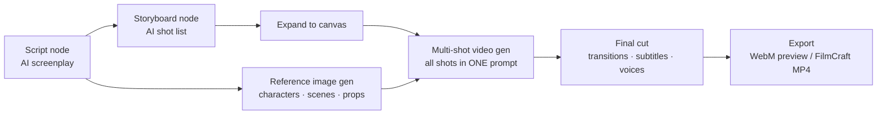

# Infinite Canvas for DeepSeek Harness

**A node-based short-drama studio inside DeepSeek Harness.** Start from a one-line idea, walk out with a storyboarded, voiced, subtitled video cut — right on an infinite canvas.

English | [简体中文](./README.zh-CN.md)

<!-- Badges: add CI / npm / license badges here after publishing -->

## What is this?

Infinite Canvas is a [DeepSeek Harness](https://github.com/deepseek-ai) plugin that turns the web GUI's sidebar into a full creation studio. Instead of chat round-trips, you work the way directors do: nodes on an infinite canvas, wired into a pipeline — script, storyboard, character & scene assets, image generation, video generation, and a final cut with transitions, subtitles and dubbing.

Everything runs locally in your Harness. Bring your own generation APIs, or use the built-in demo mode to learn the whole flow with zero configuration.

## How it works

## Highlights

### Consistent characters, scene after scene
A per-project **series bible** (style baseline + character/scene/prop cards) is injected into every AI call, so wardrobes, locations and props stay coherent across shots and episodes. After each storyboard run, a local consistency check flags any name that isn't registered yet.

### References that actually bind
Reference images connect as an ordered, visible list — `[图1] 角色：Lin Ning`, `[图2] 场景：The Old House` — and that exact order is what reaches the model. Multi-character frames stay unambiguous, and Volcano Engine **Seedance**'s native `[图N]` convention is supported end to end (first frame, up to 4 reference images, official task API).

### From shots to a watchable cut
**One storyboard = one multi-shot video generation.** Expanding a storyboard wires it to a single video node: every shot (order + per-shot duration) is composed into one multi-shot prompt and your video model renders the whole clip in one call — the model makes the hard cuts, no per-shot stitching seams. The **Final Cut node** then stitches segments in order — crossfade or black transitions, burned-in subtitles, original audio and TTS voices mixed in — and exports a preview cut instantly. For real post-production, one click writes a **FCP7 XML timeline + SRT** to disk and hands the render to [ArtCraft](#artcraft-bridge) (FilmCraft) for a true MP4.

### An editor-grade canvas
Pan, zoom, marquee select, alignment guides, groups that fold, a minimap, 60-step undo/redo, per-node media history (last 8 results), mask-based inpainting, and middle-click everything — the canvas part should feel like an editor, not a chat sidebar.

### Bring your own models
Text models come from Harness itself (no extra keys, no per-plugin parameters). Image, video and TTS backends are **multi-config** — define as many endpoints as you want, mark a default, and pick per node. Every gateway call is relayed through the local Harness host process, so **any vendor works** (no CORS headaches). No backend configured? Demo mode synthesizes placeholder images and animated videos locally so the entire pipeline is testable offline.

### A portable data root
Set a **data root folder** once and everything lands there, organized by **project name**: nodes and the series bible in `project.json`, the asset index in `assets.json`, media under `image/ video/ audio/ text/`, and Craft post-production under `craft/`. Move to a new machine by copying the folder and clicking **Import from data root**.

## Quick start

1. Install the plugin (bundle folder) and restart Harness once.
2. Click the **Infinite Canvas** button in the left sidebar.
3. Add a **Script** node, type a logline, hit *AI write script*.
4. Connect it to a **Storyboard** node → *AI break into shots* → *Expand to canvas*.
5. Drop character images onto the placeholder asset nodes, hit *Run workflow*, then open a **Final Cut** node and export.

> Without any generation API configured, every step runs in demo mode — the full pipeline works offline.

## Generation backends

| Kind | Protocol | Notes |
|---|---|---|
| Text | Harness LLM service | Script & storyboard writers; pick any configured model, or override per node |
| Image | OpenAI-compatible `/images/generations`, multi-reference via `/images/edits` | Size (1K/2K/4K) × ratio; mask inpainting via `edits` + PNG mask |
| Video | Generic submit+poll, or **Volcano Seedance official tasks** | duration up to 15 s, 480P/720P/1080P, ratio, first frame, up to 4 reference images |
| TTS | OpenAI-compatible `/audio/speech` | Per-shot voices mixed into the final cut |

All gateway calls are relayed by the local Harness host process (no browser CORS limits) — any vendor endpoint with an OpenAI-style shape works.

## ArtCraft bridge

When the companion [`dsh-artcraft`](../dsh-artcraft/README.md) plugin is installed, the canvas talks to the local **Craft family** (PhotoCraft, FilmCraft, EffectCraft, LightCraft, VectorCraft, DesignCraft, … — every bin the Craft suite reports, currently 12) over same-origin HTTP. Point ArtCraft's data root at the same folder as the canvas data root and all post-production lands in `projects/<project>/craft/` next to your other data: assets sync per project, images get headless PhotoCraft grading (single or batch), and final cuts export as FCP7 XML + SRT for FilmCraft to render as MP4. A status card in Settings shows one light per craft with an n/n ready summary.

## Publishing (maintainers)

The maintainer runbook (red lines, branch model, versioning) lives in [`RELEASING.md`](RELEASING.md); the operations detail in [`docs/release.md`](docs/release.md); released changes in [`CHANGELOG.md`](CHANGELOG.md) — **GitHub Release notes are written in English** and copied from the changelog.

Publishing runs through **npm Trusted Publishing** (OIDC) — no npm token exists anywhere:

- **Release flow**: dev tested & approved → merge to `main` → create a GitHub Release (tag `v0.17.9`, …) → Actions publishes that version automatically.
- The `publish.yml` workflow guards on the release commit being on `main` and the tag matching `package.json`, then publishes with a `provenance` badge.

## Data & privacy

- Canvas documents, projects and settings live in browser `localStorage` (`dsh-ic:*`); asset metadata lives in IndexedDB (`dsh-infinite-canvas`) while media files persist **on disk** once a data root is set (per-project folders by project name, served by the plugin backend with HTTP Range support for video seeking).
- AI text generation runs through the Harness host process (your configured models, no extra keys).
- Image/video/TTS gateway calls are relayed by the local Harness host process (avoids browser CORS limits); your endpoints and keys stay local.
- Nothing is uploaded anywhere by the plugin itself.

## Requirements & limitations

- DeepSeek Harness 0.2.0-rc.2+; demo video export needs MediaRecorder (Chromium).
- The preview cut is real-time recorded WebM; for MP4 masters with multi-track editing, pair with ArtCraft FilmCraft or any NLE.
- Image `edits`/mask inpainting requires a model that supports the endpoint (e.g. gpt-image-1).
- Host-side plugin updates need one Harness restart; the web half hot-reloads.

## License

Apache-2.0
