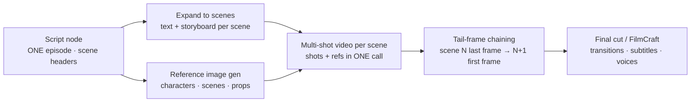

# Infinite Canvas for DeepSeek Harness

**A node-based short-drama studio inside DeepSeek Harness.** Start from a one-line idea, walk out with a storyboarded, voiced, subtitled video cut — right on an infinite canvas.

English | [简体中文](./README.zh-CN.md) · **User guide: [English](./docs/guide.en.md)** · [操作手册（中文）](./docs/guide.zh-CN.md)

<!-- Badges: add CI / npm / license badges here after publishing -->

## What is this?

Infinite Canvas is a [DeepSeek Harness](https://github.com/deepseek-ai) plugin that turns the web GUI's sidebar into a full creation studio. Instead of chat round-trips, you work the way directors do: nodes on an infinite canvas, wired into a pipeline — script, storyboard, character & scene assets, image generation, video generation, and a final cut with transitions, subtitles and dubbing.

Everything runs locally in your Harness. Bring your own generation APIs, or use the built-in demo mode to learn the whole flow with zero configuration.

## Drive it from the chat

The canvas and the agent share one brain. Every node is an AI workbench, and the **chat side is the director**: ask in plain language and the agent operates the canvas tools for you — batch work especially.

> *"Create a project called Time-Postman, write the world view and series bible first."*
> *"Write episode 1 based on the bible."* → the script node generates one episode (60–120s), every scene marked with a `【场N】` header.
> *"Expand episode 1 into scenes."* → per-scene text nodes + storyboard nodes appear, wired automatically.
> *"Generate reference images for every character, scene and prop."* → ten image nodes created and generated in one go.
> *"Generate scene 1's video."* → storyboard shots + reference images compose one multi-shot video call.
> *"Send episode 1 to FilmCraft for an MP4 render."* → FCP7 XML + SRT land in your data root for the Craft suite.

The heavy lifting — bibles, episode scripts, storyboard breakdowns, batches of reference images — is exactly what the agent is fast at. You then fine-tune the 20% you care about directly on the nodes: tweak a prompt, reorder references, re-roll one shot, pull an older result from history.

## Case study: Time-Postman (时空邮递员)

A full episode produced end to end with the flow above. The canvas at 32% — the script node, the expanded per-scene text + storyboard groups, the scene-1 video node with its bound references and preview, and the Assets panel:

Scene 1 up close — text → storyboard → video wiring, with the storyboard's shot list and the video node's bound references:

A scene video node: model picked from the provider's model list, duration/ratio/resolution on the node, four reference images bound in order:

Providers are configured once (URL + key + vendor-specific extra params) and can hold many models — one is starred as the default route:

The Settings panel — data root, Craft status (12/12 ready), skills, text model, and the image/video/TTS provider lists (EN / 中文 versions of the same UI):

## Work beside the chat

The canvas is not a separate window you have to switch to. It opens as a **tab in the Harness right pane**, so you can talk to the agent on the left and storyboard on the right **at the same time** — ask for a change in chat and watch the nodes update in place.

1. Open the right pane (**开始 / Start**) and click the **无限画布 / Infinite Canvas** card.
2. The canvas opens as a tab beside the conversation; the same projects, nodes and assets as the full-page panel.
3. Drag the pane wider, or use the pane's fullscreen button, when you need more room.

> One live canvas at a time (shared node graph and generation state): opening it in the pane while the full-page panel is also open **moves** the canvas rather than duplicating it — the other side shows a "move the canvas here" button.

## How it works

## Highlights

### Consistent characters, scene after scene
A per-project **series bible** (style baseline + character/scene/prop cards) is injected into every AI call, so wardrobes, locations and props stay coherent across shots and episodes. Entities referenced with `@name` in a prompt automatically carry their bible description and reference assets. After each storyboard run, a consistency check flags any name that isn't registered yet, and the agent fills the gaps.

### References that actually bind
Reference images connect as an ordered, visible list — `[图1] 角色：Lin Ning`, `[图2] 场景：The Old House` — and that exact order is what reaches the model. Multi-character frames stay unambiguous, and Volcano Engine **Seedance**'s native `[图N]` convention is supported end to end (first frame, up to 4 reference images, official task API).

### From shots to a watchable cut
**One storyboard = one multi-shot video generation.** Expanding a storyboard wires it to a single video node: every shot (order + per-shot duration) is composed into one multi-shot prompt and your video model renders the whole clip in one call — the model makes the hard cuts, no per-shot stitching seams. The **Final Cut node** then stitches segments in order — crossfade or black transitions, burned-in subtitles, original audio and TTS voices mixed in — and exports a preview cut instantly. For real post-production, one click writes a **FCP7 XML timeline + SRT** to disk and hands the render to [ArtCraft](#artcraft-bridge) (FilmCraft) for a true MP4.

### An editor-grade canvas
Pan, zoom, marquee select, alignment guides, groups that fold, a minimap, 60-step undo/redo, per-node media history (last 8 results), mask-based inpainting, and middle-click everything — the canvas part should feel like an editor, not a chat sidebar.

### Bring your own models
Text models come from Harness itself (no extra keys, no per-plugin parameters). Image and video backends use a **provider + model** structure: configure a provider once (URL, key, optional vendor-specific **extra params** as JSON) and list as many model IDs under it as you like; star one as the **default route** for nodes that don't pick one. Video endpoints are auto-adapted — OpenAI-style task APIs, Seedance-native `content[]` gateways and Sora-style `/v1/videos` are covered by an automatic fallback chain, resolutions/ratios/first-frames/references are mapped to each vendor's conventions, and oversized references are downscaled before sending. Every gateway call is relayed through the local Harness host process, so **any vendor works** (no CORS headaches). No backend configured? Demo mode synthesizes placeholder images and animated videos locally so the entire pipeline is testable offline.

### A portable data root
Set a **data root folder** once and everything lands there, organized by **project name**: nodes and the series bible in `project.json`, the asset index in `assets.json`, media under `image/ video/ audio/ text/`, and Craft post-production under `craft/`. **Moving to a new machine = copying the folder**: point the new install's data root at it and every project (assets, bible, media) is recognized — plus a one-click **Import from data root** for anything not yet on disk. Put the folder inside a cloud-sync directory and multiple machines stay in sync automatically.

## Quick start

1. Install the plugin (bundle folder) and restart Harness once.
2. Click the **Infinite Canvas** button in the left sidebar, and set a **data root** in Settings.
3. In the chat: *"Create a project called <your idea>, write the world view and series bible first."*
4. *"Write episode 1."* → script node generates one episode with `【场N】` scene headers → click **Expand to scenes** (or ask the agent) to get text + storyboard nodes per scene.
5. *"Generate reference images for all characters, scenes and props."* → named, bible-consistent asset images in one batch.
6. *"Generate scene 1's video."* → storyboard shots + references compose one multi-shot video call; chain scenes via tail-frame → first-frame.
7. Open a **Final Cut** node for the preview cut, or export to FilmCraft for a true MP4.

> Without any generation API configured, every step runs in demo mode — the full pipeline works offline.

The full walkthrough (with screenshots, model configuration and data-root migration) lives in the [Chinese user guide](./docs/guide.zh-CN.md).

## Generation backends

| Kind | Protocol | Notes |
|---|---|---|
| Text | Harness LLM service | Episode scripts & storyboard writers; pick any configured model, or override per node |
| Image | OpenAI-compatible `/images/generations`, multi-reference via `/images/edits` | Provider + model list with starred default; size (1K/2K/4K) × ratio; extra params as JSON; mask inpainting via `edits` + PNG mask |
| Video | OpenAI-style task APIs, Seedance-native `content[]`, Sora-style `/v1/videos` — automatic fallback chain | Episodes per scene (≤15s), 480P/720P/1080P, ratio, first frame, multi-reference (auto-downscaled), voice references via `audios[]` |
| TTS | OpenAI-compatible `/audio/speech` | Per-shot voices mixed into the final cut |

All gateway calls are relayed by the local Harness host process (no browser CORS limits) — any vendor endpoint with an OpenAI-style shape works.

## ArtCraft bridge

When the companion [`dsh-artcraft`](../dsh-artcraft/README.md) plugin is installed, the canvas talks to the local **Craft family** (PhotoCraft, FilmCraft, EffectCraft, LightCraft, VectorCraft, DesignCraft, … — every bin the Craft suite reports, currently 12) over same-origin HTTP. Point ArtCraft's data root at the same folder as the canvas data root and all post-production lands in `projects/<project>/craft/` next to your other data: assets sync per project, images get headless PhotoCraft grading (single or batch), and final cuts export as FCP7 XML + SRT for FilmCraft to render as MP4. A status card in Settings shows one light per craft with an n/n ready summary.

## Publishing (maintainers)

The maintainer runbook (red lines, branch model, versioning) lives in [`RELEASING.md`](RELEASING.md); the operations detail in [`docs/release.md`](docs/release.md); released changes in [`CHANGELOG.md`](CHANGELOG.md) — **GitHub Release notes are written in English** and copied from the changelog.

Publishing runs through **npm Trusted Publishing** (OIDC) — no npm token exists anywhere:

- **Release flow**: dev tested & approved → merge to `main` → create a GitHub Release (tag `v0.17.9`, …) → Actions publishes that version automatically.
- The `publish.yml` workflow guards on the release commit being on `main` and the tag matching `package.json`, then publishes with a `provenance` badge.

## Data & privacy

- Canvas documents, projects and settings live in browser `localStorage` (`dsh-ic:*`); asset metadata lives in IndexedDB (`dsh-infinite-canvas`) while media files persist **on disk** once a data root is set (per-project folders by project name, served by the plugin backend with HTTP Range support for video seeking).
- AI text generation runs through the Harness host process (your configured models, no extra keys).
- Image/video/TTS gateway calls are relayed by the local Harness host process (avoids browser CORS limits); your endpoints and keys stay local.
- Nothing is uploaded anywhere by the plugin itself.

## Requirements & limitations

- DeepSeek Harness 0.2.0-rc.2+; demo video export needs MediaRecorder (Chromium).
- The preview cut is real-time recorded WebM; for MP4 masters with multi-track editing, pair with ArtCraft FilmCraft or any NLE.
- Image `edits`/mask inpainting requires a model that supports the endpoint (e.g. gpt-image-1).
- Host-side plugin updates need one Harness restart; the web half hot-reloads.

## License

Apache-2.0
