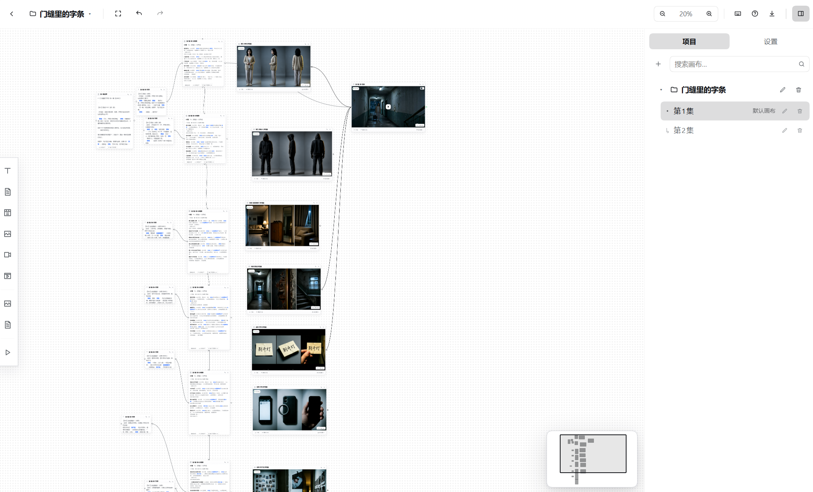
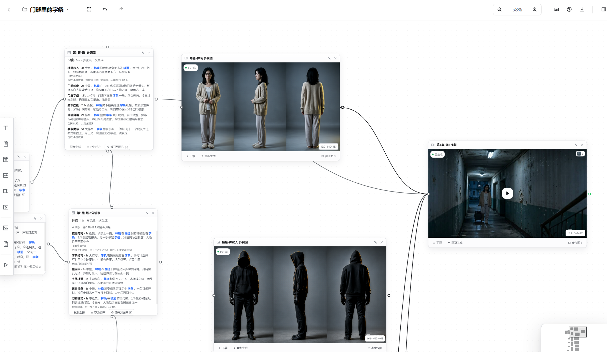
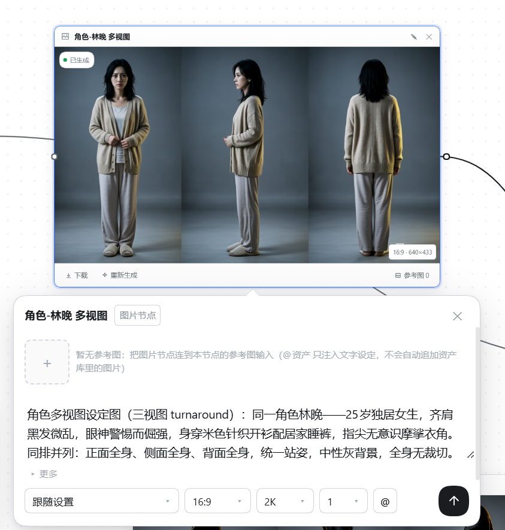
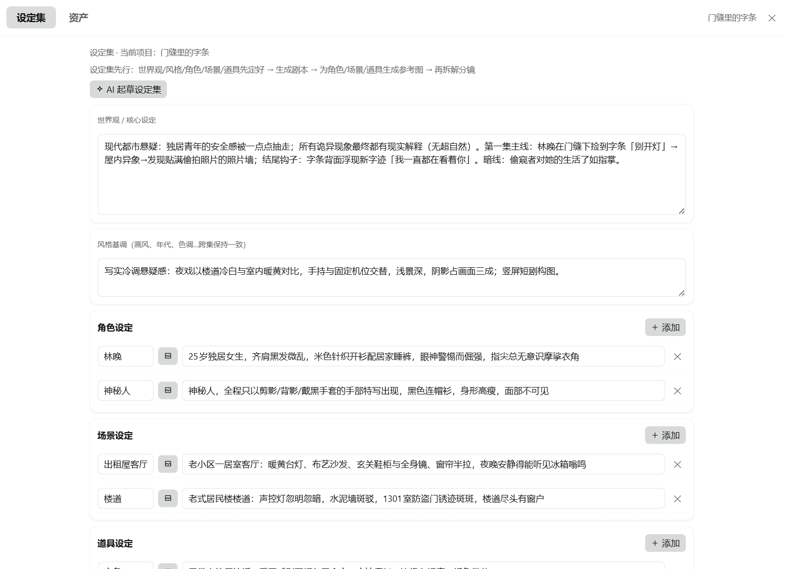
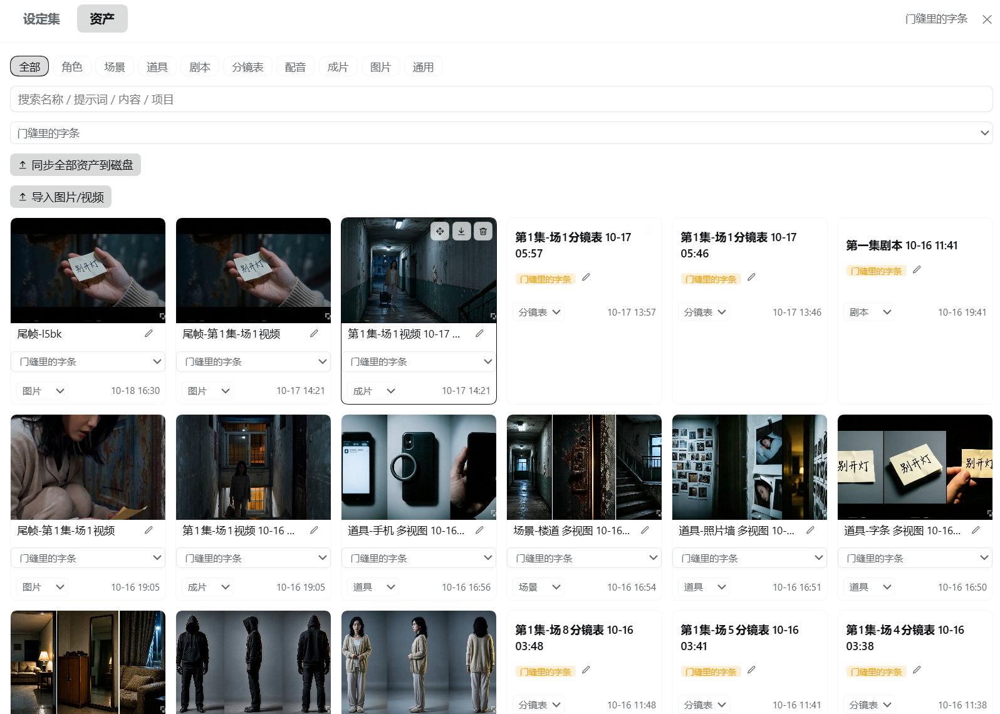
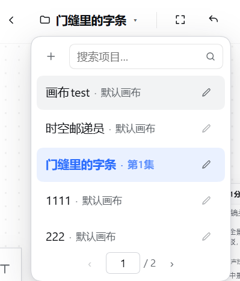
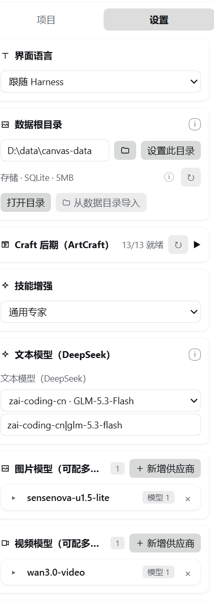
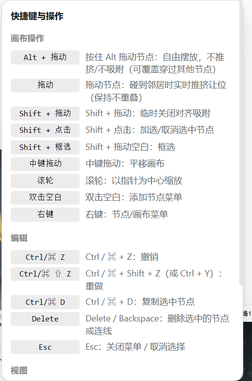
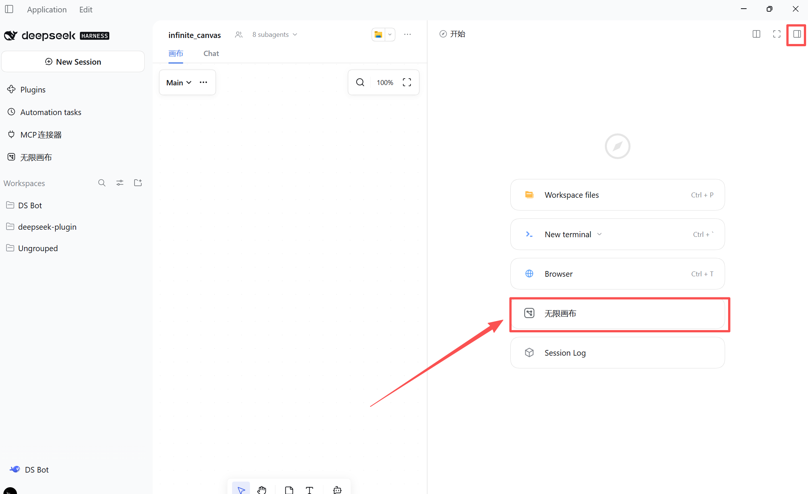
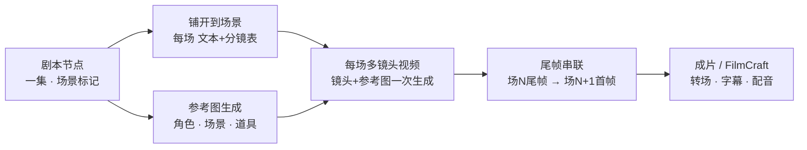

# 无限画布（DeepSeek Harness 版）

**DeepSeek Harness 内的节点式短剧工作室。** 从一句话创意出发，在无限画布上完成剧本、分镜、角色资产、画面生成、视频生成，直到带转场、字幕、配音的成片。

[English](./README.md) | 简体中文 · **操作手册：[中文版](./docs/guide.zh-CN.md)** · [English guide](./docs/guide.en.md)

<!-- 徽标位：发布后在顶部添加 CI / npm / license 徽标 -->

## 这是什么？

无限画布是一个 [DeepSeek Harness](https://github.com/deepseek-ai) 插件：它在 Web 界面侧边栏加入一个完整的创作工作室。你像导演一样工作——无限画布上的节点连成流水线：剧本、分镜、角色与场景资产、图片生成、视频生成，最终在成片节点完成转场、字幕与配音。

全部本地运行于你的 Harness。生成后端自带或自配均可；未配置任何 API 时有内置演示模式，整条流水线离线可学可测。

## 用对话驱动画布

画布与对话共享同一个"大脑"。每个节点都是一个 AI 工位，而**对话侧就是导演**：用自然语言下指令，Agent 替你操作画布工具——批量工作尤其如此。

> 「创建一个叫《时空邮递员》的项目，先写世界观和设定集。」
> 「根据设定集写第一集。」→ 剧本节点生成一整集（60–120 秒），每个场景带【场N】分场标记。
> 「把第一集铺开到场景。」→ 每场一个文本节点 + 分镜表节点自动出现并连线。
> 「把所有角色、场景、道具的参考图都生成了。」→ 十个图片节点一次建好、逐个生成。
> 「生成场1的视频。」→ 分镜镜头 + 参考图合成一次多镜头视频调用。
> 「把第一集交给 FilmCraft 渲染 MP4。」→ FCP7 XML + SRT 落盘，Craft 套件接手。

设定集、整集剧本、分镜拆解、成批参考图——这些批量工作正是 Agent 最快的部分。跑完后你只需要在画布上精修真正在意的那 20%：改提示词、调参考图顺序、重掷某一个镜头、从历史里回退旧结果。

## 案例：门缝里的字条

用上面的流程完整制作的一集。整集铺开后的画布全览——左侧一列图标添加节点，右侧「项目」面板管理当前项目的画布（第1集 / 第2集），资产与设定集在项目内共享：

场1 的镜头组——场1分镜表 → 角色/场景多视图 → 场1视频，节点之间用连线表达参考关系：

节点 + 生成面板：点击节点内容区弹出面板，参考图在顶部缩略图条里可拖拽排序，模型/比例/清晰度/张数一行排开：

设定集弹窗——世界观、风格基调、角色/场景/道具条目，每条都可以绑定参考资产：

资产弹窗——卡片网格，搜索/分类/项目筛选，视频以首帧作为缩略图：

左上角项目名点开是项目下拉：每行显示「项目名 · 画布名」，可直接就地改名，超过 5 个项目自动分页并可跳页：

设置页签——数据根目录、Craft 状态、技能增强（通用专家）、文本模型与图片/视频/TTS 供应商：

快捷键与操作：

帮助与反馈：

## 在对话旁边工作

画布不是必须切过去的另一个窗口——它可以作为 **Harness 右侧面板里的一个页签**打开，左边对话、右边分镜，**同时进行**：在对话里提要求，右边节点实时跟着变。

1. 打开右侧面板（**开始**），点击 **无限画布** 卡片。
2. 画布以页签形式出现在对话右侧，与全屏面板共享同一批项目、节点与资产。
3. 需要更大空间时，把右栏拖宽，或用右栏的全屏按钮。

> 同一时刻只有一个画布实例（共享节点图与生成状态）：在右栏打开时若全屏面板也开着，画布会**被移动到右栏**而不是复制一份——另一侧显示「把画布切换到这里」按钮。

## 工作方式

## 核心亮点

### 角色一致，跨镜跨集
项目级**设定集**（风格基调 + 角色/场景/道具卡）注入每一次 AI 调用，服装、场景、道具跨镜跨集保持一致。提示词里的 `@名称` 自动携带该实体的设定描述与参考资产。每次分镜生成后一致性检查会标出未登记实体，Agent 自动补全。

### 参考图真正绑定
参考图以有序、可见的列表连线（`[图1] 角色：陈拾`、`[图2] 场景：褶皱巷`），这个顺序就是到达模型的顺序。多角色画面不再含糊；Volcano **Seedance** 的原生 `[图N]` 约定端到端支持（首帧、最多 4 张参考图、官方任务 API）。

### 从分镜到可看成片
**一个分镜表 = 一次多镜头视频生成。** 全部镜头（顺序 + 每镜时长）合成一条提示词，视频模型一次调用渲染整段——硬切由模型完成，没有逐镜拼接的接缝。每场 ≤ 15 秒，多场之间用**尾帧 → 首帧**串联。**成片节点**按顺序拼接片段——交叉溶解或黑场转场、烧录字幕、原声与 TTS 配音混音——即时导出预览版；接 [ArtCraft](#artcraft-桥接)（FilmCraft）则写出 **FCP7 XML 时间线 + SRT** 渲染真正的 MP4。

### 编辑器级画布
平移缩放、框选、对齐参考线、可折叠分组、小地图、60 步撤销重做、节点媒体历史（最近 8 次）、蒙版局部重绘、全要素中键——画布应该像剪辑软件，不像聊天侧栏。

### 模型自带或自配
文本模型直接来自 Harness（无额外 Key）。图片/视频后端采用**供应商 + 模型**两级结构：供应商配一次（地址、Key、可选的厂商专属**扩展参数 JSON**），下面挂任意多个模型 ID，点 ★ 星标作为默认路由。视频端点自动适配——OpenAI 风格任务接口、Seedance 原生 `content[]`、Sora 风格 `/v1/videos` 由自动降级链覆盖，分辨率/比例/首帧/参考图按厂商惯例映射，超大参考图发送前自动压缩。所有网关调用经本地 Harness 宿主进程转发（无浏览器 CORS 限制）。什么都没配？演示模式本地合成占位图与动画视频，整条流水线离线可测。

### 便携数据根目录
设置一次**数据根目录**，所有数据按**项目名**落盘：节点与设定集在 `project.json`，资产索引在 `assets.json`，媒体在 `image/ video/ audio/ text/`，Craft 后期产物在 `craft/`。**换电脑 = 复制文件夹**：新机器把数据根目录指过去，所有项目（资产、设定集、媒体）自动识别——另有**「从数据根导入」**一键合并。把目录放进网盘同步文件夹，多台机器自动保持一致。

## 快速开始

1. 安装插件（bundle 目录）并重启一次 Harness。
2. 点侧边栏 **Infinite Canvas**，在设置里配好**数据根目录**。
3. 对话：*「创建一个项目叫〈你的创意〉，先写世界观和设定集。」*
4. *「写第一集。」* → 剧本节点生成带【场N】标记的一集 → 点**铺开到场景**（或让 Agent 做），得到每场的文本+分镜表组合。
5. *「把所有角色、场景、道具的参考图生成了。」* → 一批命名规范、与设定集一致的资产图。
6. *「生成场1的视频。」* → 分镜镜头 + 参考图合成一次多镜头调用；场与场之间尾帧串联。
7. 打开**成片节点**导出预览版，或交给 FilmCraft 渲染正式 MP4。

> 未配置任何生成 API 时，全部步骤以演示模式运行——整条流水线离线可用。

完整的图文教程（含截图、模型配置与数据目录迁移）见[中文操作手册](./docs/guide.zh-CN.md)。

## 生成后端

| 类型 | 协议 | 说明 |
|---|---|---|
| 文本 | Harness LLM 服务 | 整集剧本与分镜拆解；可选任意已配置模型，或按节点覆盖 |
| 图片 | OpenAI 兼容 `/images/generations`，多参考走 `/images/edits` | 供应商+模型列表（星标默认）；尺寸（1K/2K/4K）× 比例；扩展参数 JSON；`edits`+PNG 蒙版局部重绘 |
| 视频 | OpenAI 风格任务接口、Seedance 原生 `content[]`、Sora 风格 `/v1/videos`——自动降级链 | 每场一集（≤15s）、480P/720P/1080P、比例、首帧、多参考图（自动压缩）、`audios[]` 声音参考 |
| TTS | OpenAI 兼容 `/audio/speech` | 每镜配音混入成片 |

所有网关调用由本地 Harness 宿主进程转发（无浏览器 CORS 限制）——任何 OpenAI 风格的厂商端点都可用。

## ArtCraft 桥接

安装姊妹插件 [`dsh-artcraft`](../dsh-artcraft/README.md) 后，画布可与本地 **Craft 家族**（PhotoCraft、FilmCraft、EffectCraft、LightCraft、VectorCraft、DesignCraft 等 12 个）经同源 HTTP 协作。把 ArtCraft 的数据根目录指向与画布相同的位置，全部后期产物落在 `projects/<项目>/craft/`：资产按项目同步、图片支持 PhotoCraft 无头调色（单个/批量）、成片导出 FCP7 XML + SRT 交 FilmCraft 渲染 MP4。设置面板的状态卡为每个 Craft 显示一盏状态灯与 n/n 就绪摘要。

## 发布（维护者）

维护者手册（红线、分支模型、版本规则）见 [`RELEASING.md`](RELEASING.md)；操作细节见 [`docs/release.md`](docs/release.md)；已发布变更见 [`CHANGELOG.md`](CHANGELOG.md)——**GitHub Release 正文一律英文**，从 changelog 复制。

发布走 **npm Trusted Publishing**（OIDC）——任何地方都不存在 npm 令牌：

- **发布流程**：dev 测试通过并获批准 → 合并进 `main` → 创建 GitHub Release（tag `v0.17.11`，…）→ Actions 自动发布该版本。
- `publish.yml` 工作流内置守卫：release 提交必须在 `main` 上、tag 必须与 `package.json` 一致，然后带 `provenance` 徽章发布。

## 数据与隐私

- 画布文档、项目与设置存于浏览器 `localStorage`（`dsh-ic:*`）；资产元数据存于 IndexedDB（`dsh-infinite-canvas`）；设置数据根目录后媒体文件**落盘**（按项目名分目录，插件后端带 HTTP Range 支持视频拖动）。
- AI 文本生成经 Harness 宿主进程（用你已配置的模型，无额外 Key）。
- 图片/视频/TTS 网关调用由本地 Harness 宿主进程转发（规避浏览器 CORS）；你的端点与 Key 都留在本地。
- 插件自身不向任何第三方上传数据。

## 环境与限制

- DeepSeek Harness 0.2.0-rc.2+；演示模式成片导出需要 MediaRecorder（Chromium）。
- 预览成片为实时录制 WebM；多轨剪辑的 MP4 母版请配合 ArtCraft FilmCraft 或任意 NLE。
- 图片 `edits`/蒙版重绘需要模型支持该端点（如 gpt-image-1）。
- 宿主侧插件更新需重启一次 Harness；Web 半区热加载。

## 许可证

Apache-2.0
