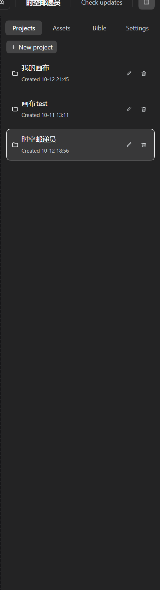
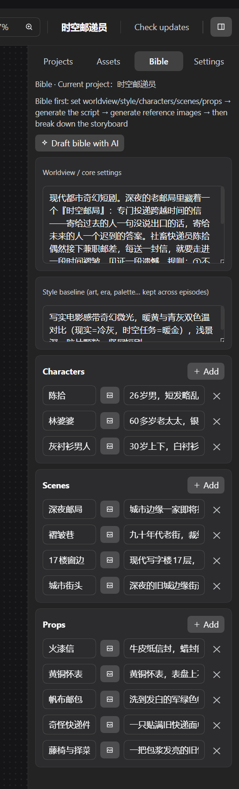

# Infinite Canvas User Guide — Case Study: "Time-Postman" (时空邮递员)

> **中文版：[guide.zh-CN.md](./guide.zh-CN.md)**
> This guide walks through a complete episode produced with the current UI. All screenshots are from the real production run.
> Core idea in one line: **let the Harness chat handle the batch work; fine-tune the details on the canvas yourself.**

---

## 1. What it is

Infinite Canvas is a DeepSeek Harness plugin that turns the sidebar into a node-based short-drama studio. Scripts, the series bible, storyboards, reference images, videos and final cuts all live as **nodes** on an infinite canvas, wired into a pipeline.

Two ways to drive it, best combined:

| Mode | Best for |
|---|---|
| **Harness chat (recommended primary)** | Batch & pipeline work: world view, full episode scripts, storyboard breakdowns, batches of reference images, per-scene videos — one sentence, the agent drives the canvas tools |
| **Manual canvas editing** (fine-tuning) | When a specific result isn't right: edit the prompt on the node and regenerate, tweak duration/ratio, reorder references, roll back history |

---

## 2. Setup

1. Install the plugin (bundle folder) and **restart Harness once**. Open a workspace session — the **Infinite Canvas** entry appears; open the canvas panel.
2. The right panel has four tabs: **Projects / Assets / Bible / Settings**.



3. First time: finish the basics in the **Settings** tab (see section 5), then start from the chat.

### 2.1 Keep the canvas beside the chat (right-pane tab)

You don't have to flip between the **Chat** and **Canvas** views: the canvas also opens as a tab in the **Harness right pane**, so you can talk on the left and storyboard on the right at the same time.

1. Open the right pane (titled **开始 / Start**).
2. Click the **无限画布 / Infinite Canvas** card — the canvas opens as a tab beside the conversation, sharing the same projects, nodes and assets as the full-page panel.
3. Drag the pane wider, or use the pane's fullscreen button, for more canvas room.


> **One live canvas at a time** (shared node graph and generation state). If the full-page panel is also open, opening it in the pane **moves** the canvas there instead of duplicating it — the other side shows a "move the canvas here" button to bring it back.

---

## 3. The core: driving the canvas from chat (a full episode)

### 3.1 World view & series bible

**You say:**

> "Use 'Time-Postman' as the sample project — write the world view and series bible first."

**The agent**: creates the project → writes the world view, style baseline, characters (Chen Shi / Granny Lin), scenes (Night Post Office / Wrinkled Alley / City Street), props (Fire-Seal Letter / Brass Pocket Watch / Canvas Mailbag…) into the **bible**.



**Why the bible matters**: it is the single source of truth for cross-shot, cross-episode consistency — every script, storyboard and video call automatically carries it; an `@Chen Shi` mention in a prompt automatically attaches that entity's description and reference assets, so **you never re-describe a character's looks**.

> 💡 Batch tip: "Fill in every character/scene/prop description until it's production-ready" — pure batch form-filling, far faster via chat.

### 3.2 Write the script (one episode = 60–120s of screen time)

**You say:**

> "Write episode 1, 'The Green Light of the Night Post Office', based on the bible."

**The agent**: creates the Episode-1 script node and runs it. The script automatically satisfies: one episode of 1–2 minutes in 4–10 scenes; **every scene starts with its own `【场N】name (location · time)` header** (the parse hook for the next step); each scene holds 10–15 seconds; dialogue on its own lines as `Character: line`.

### 3.3 Expand into scenes

Click **"Expand to scenes"** on the script node, or tell the agent: "Expand episode 1 into scenes." The canvas fills in one group per scene:

```
Ep1-Scene1 text ──→ Ep1-Scene1 storyboard
Ep1-Scene2 text ──→ Ep1-Scene2 storyboard
… (one wire per scene; one generation per 10–15s scene video)
```

Each storyboard is broken into a shot list by AI: per shot — visual, motion & camera, characters/scene/props (`@name` references), duration, and **dialogue annotations** (which line belongs to which character — the voice-reference extractor relies on this). Shot count follows the actual action beats; the total stays ≤ 15 seconds.

The canvas after the episode is expanded (left: script → per-scene texts → per-scene storyboards):


### 3.4 Generate reference images (characters / scenes / props)

**You say:**

> "Generate reference images for every character, scene and prop, following the naming convention."

**The agent**: batch-creates image nodes (`Character-ChenShi multi-view`, `Scene-NightPostOffice multi-view`, `Prop-FireSealLetter multi-view`…) and runs them. Before generating it runs a **consistency check**: entities that appear in shots but aren't registered (or have empty descriptions) raise warnings, and the agent fills the bible first.

Generated assets land in the **Assets** tab, organized by category (Character / Scene / Prop / Script / Storyboard / Voice / Final cut):


> 💡 Batch tip: ten reference images and six storyboards are exactly the kind of repetitive work the chat side is fastest at — one sentence does it all; you just review the images.

### 3.5 Storyboard + references → scene video

**You say:**

> "Generate scene 1's video."

**The agent**:

1. Reads scene 1's shot list from the storyboard (the shot sequence comes from there, never invented);
2. Creates a video node wired to the storyboard — all shots (order + durations) compose ONE prompt and the video model renders the whole clip in one call (hard cuts by the model);
3. Wires the scene's reference assets to the video node's reference port (`[图1] Character-ChenShi, [图2] Scene-CityStreet…`); `@mentions` in the prompt attach their assets automatically;
4. Runs and polls; when done it **extracts the tail frame** onto the `last` port — scene 2 chains via tail-frame → first-frame for visual continuity.

Scene 1's result: the video node with preview, bound references, and the tail-frame asset (the Assets panel gains "Ep1-Scene1 video" and "tail frame" cards):


### 3.6 Post-production with the Craft family

With the companion [ArtCraft](../dsh-artcraft/README.md) plugin installed, the canvas works with the local Craft suite (12 apps: PhotoCraft imaging / FilmCraft editing+render / SoundCraft audio…):

- **You say:** "Export scenes 1–6 to FilmCraft as an MP4 in order, subtitles from the shot dialogue."
- The final-cut node writes a **FCP7 XML timeline + SRT subtitles** into the data root's `craft/` folder — FilmCraft opens and renders;
- Single assets go to PhotoCraft for grading in one click; the Settings Craft card shows 12 status lights (12/12 ready in the screenshots).

### 3.7 The whole flow

```
chat:  world view/bible → episode script → expand to scenes → batch refs → per-scene videos → craft post
canvas: project card     script node      text+storyboard ×N   ref image nodes ×N   video nodes ×N   craft/ output
```

---

## 4. Manual fine-tuning: nodes are the workbench

After the chat batch is done, the canvas is where you polish:

- **Regenerate**: edit the prompt/idea on a node and hit generate again;
- **Swap references**: the video node's reference list supports reorder (↑↓), remove, and re-attach from the asset page;
- **Parameters**: per-scene duration (≤15s), ratio (16:9/9:16…), resolution (720P/1080P) switch right on the node;
- **Mask inpainting**: image nodes support brush-mask partial redraw;
- **History**: each media node keeps the last 8 results — click a thumbnail to roll back;
- **Re-wire**: unhappy with a scene's storyboard? Wire its text node to another storyboard and re-break.

**Recommended rhythm**: let chat finish the 80% batch → polish the 20% you care about on the canvas → have chat re-run the changed parts.

---

## 5. Model configuration: providers + models

Settings tab → Image models / Video models / TTS voices, organized in **two levels**:

1. **Provider** (collapsed row): configure the endpoint + API key **once** (+ optional extra params);
2. **Models**: list several model IDs under it (same vendor, different tiers); **star ★ one as the default** — nodes without an explicit pick route there automatically.


Expand a provider to edit its details (endpoint, key, output format, extra params, model list):


Key points:

- **Fill the endpoint any way you like**: bare domain (`https://api.xxx.com`), up to `/v1`, or the full endpoint — the canvas normalizes it;
- **Extra params (JSON, optional)**: vendor-specific keys (`watermark`, `prompt_extend`, `output_format`, `seed`…) merge into the request body last — switching vendors needs zero code;
- **Node model dropdowns** list every configured model (starred ones carry ★); empty = the starred default; with nothing configured, a run fails with a clear error;
- **Compatibility**: OpenAI-style task APIs, Seedance-native `content[]` and Sora-style `/v1/videos` are auto-detected with a fallback chain; resolution/ratio/first-frame/references are mapped to each vendor's conventions;
- **Text models** use whatever Harness has configured — no extra keys;
- **TTS voices**: same provider structure, mixed into the final cut per shot.

---

## 6. Data root: setup & cross-machine migration

### 6.1 Set the data root

Settings tab → **Data root**: enter a local folder (e.g. `D:\model\canvas-data`) → **Set directory**. Everything is persisted per **project name**:

```
<data root>/
├─ canvas.meta.json          # project id → folder mapping
└─ projects/
   └─ Time-Postman/
      ├─ project.json        # canvas doc (nodes/edges/bible)
      ├─ assets.json         # asset index
      ├─ image/  video/  audio/  text/   # media by type
      └─ craft/              # Craft post-production output (XML/SRT/MP4)
```

**Open folder** opens it in Explorer; **Import from data root** merges disk projects into the canvas in one click.

> Tip: put the data root inside a **cloud-sync folder** (OneDrive/Nutstore/…) and multiple machines stay in sync automatically.

### 6.2 Copying to another machine

1. **Old machine**: copy the whole data root to a USB drive / cloud folder;
2. **New machine**: install the plugin → point Settings → Data root at the copied folder → **auto-recognized**, existing projects appear in the project list;
3. For any browser-local leftovers, click **Import from data root** to merge.

Media lives on disk, organized by project — **copying the folder IS the full migration** (images, videos, audio, scripts and the bible included).

---

## 7. Assets & the bible

### Assets tab

- Everything generated or imported — images, videos, audio, text — in one place; filter by category: All / Character / Scene / Prop / Script / **Storyboard** / **Voice** / **Final cut** / General;
- Each asset card: project dropdown (editable), category dropdown (editable), rename (✎), creation time;
- **Sync all assets to disk**: flush every browser-held asset to the data root;
- **Import image/video**: bring local files in as assets (e.g. a character's line clipped in an NLE);
- Deleting an asset **also deletes the file on disk**.

### Series bible

- One per project: world view / style baseline / characters / scenes / props; "✦ Draft bible with AI" fills it in one click;
- **Injected into everything**: every script, storyboard, image and video call carries it — cross-shot, cross-episode consistency;
- **Bind assets to entities** (📷 button): give "Chen Shi" his multi-view sheet + voice reference, and `@Chen Shi` carries them automatically;
- **Consistency warnings**: unregistered entities appearing in storyboards raise warnings that the agent resolves (names verbatim).

### Voice references (character voice consistency)

1. Check "generate synced audio" on the video provider → generated clips carry their own audio track;
2. On a video/final-cut node click **"Extract voice reference"** → type the character name → every dialogue window is located automatically from the storyboard `dialogue` annotations and merged into one `Character-<name> voice` audio asset (auto-bound to the entity);
3. From then on, `@<name>` in that character's video prompts attaches the voice reference (`audios[]`) and the generated speech aligns to it.

---

## 8. Troubleshooting

| Symptom | Cause & fix |
|---|---|
| Video fails with HTTP 413 | References too large — fixed since 0.17.11 (auto 1024px JPEG downscale); upgrade |
| Video 404 / "Unsupported model type" | The gateway endpoint doesn't serve that model's channel: verify the endpoint URL and model ID (copy from the platform's model list); some platforms also need the right **token group**; the canvas automatically falls back to Seedance-native `content[]` and `/v1/videos` |
| Video 503 supply unavailable | The platform's model supply is temporarily down — retry later |
| Deleted nodes come back | Old sync race — upgrade to 0.17.11+ |
| Storyboards always have exactly 6 shots | Old anchoring issue — since 0.17.11 shot counts follow the content beats |
| Demo-mode images | No model configured, or the node has no pick and no starred default — see section 5 |
