# Infinite Canvas User Guide — Case Study: "Time-Postman" (时空邮递员)

> **中文版：[guide.zh-CN.md](./guide.zh-CN.md)**
> This guide walks through a complete episode produced with the current UI. All screenshots are from the real production run.
> Core idea in one line: **let the Harness chat handle the batch work; fine-tune the details on the canvas yourself.**

---

## 1. What it is

Infinite Canvas is a DeepSeek Harness plugin that turns the sidebar into a node-based short-drama studio. Scripts, the series bible, storyboards, reference images, videos and final cuts all live as **nodes** on an infinite canvas, wired into a pipeline.

Two ways to drive it, best combined:

| Mode | Best for |
|---|---|
| **Harness chat (recommended primary)** | Batch & pipeline work: world view, full episode scripts, storyboard breakdowns, batches of reference images, per-scene videos — one sentence, the agent drives the canvas tools |
| **Manual canvas editing** (fine-tuning) | When a specific result isn't right: edit the prompt on the node and regenerate, tweak duration/ratio, reorder references, roll back history |

---

## 2. Setup

1. Install the plugin (bundle folder) and **restart Harness once**. Open a workspace session — the **Infinite Canvas** entry appears; open the canvas panel.
2. The right panel has four tabs: **Projects / Assets / Bible / Settings**.


3. First time: finish the basics in the **Settings** tab (see section 5), then start from the chat.

### 2.1 Keep the canvas beside the chat (right-pane tab)

You don't have to flip between the **Chat** and **Canvas** views: the canvas also opens as a tab in the **Harness right pane**, so you can talk on the left and storyboard on the right at the same time.

1. Open the right pane (titled **开始 / Start**).
2. Click the **无限画布 / Infinite Canvas** card — the canvas opens as a tab beside the conversation, sharing the same projects, nodes and assets as the full-page panel.
3. Drag the pane wider, or use the pane's fullscreen button, for more canvas room.


> **One live canvas at a time** (shared node graph and generation state). If the full-page panel is also open, opening it in the pane **moves** the canvas there instead of duplicating it — the other side shows a "move the canvas here" button to bring it back.

---

## 3. The core: driving the canvas from chat (a full episode)

### 3.1 World view & series bible

**You say:**

> "Use 'Time-Postman' as the sample project — write the world view and series bible first."

**The agent**: creates the project → writes the world view, style baseline, characters (Chen Shi / Granny Lin), scenes (Night Post Office / Wrinkled Alley / City Street), props (Fire-Seal Letter / Brass Pocket Watch / Canvas Mailbag…) into the **bible**.


**Why the bible matters**: it is the single source of truth for cross-shot, cross-episode consistency — every script, storyboard and video call automatically carries it; an `@Chen Shi` mention in a prompt automatically attaches that entity's description and reference assets, so **you never re-describe a character's looks**.

> 💡 Batch tip: "Fill in every character/scene/prop description until it's production-ready" — pure batch form-filling, far faster via chat.

### 3.2 Write the script (one episode = 60–120s of screen time)

**You say:**

> "Write episode 1, 'The Green Light of the Night Post Office', based on the bible."

**The agent**: creates the Episode-1 script node and runs it. The script automatically satisfies: one episode of 1–2 minutes in 4–10 scenes; **every scene starts with its own `【场N】name (location · time)` header** (the parse hook for the next step); each scene holds 10–15 seconds; dialogue on its own lines as `Character: line`.

### 3.3 Expand into scenes

Click **"Expand to scenes"** on the script node, or tell the agent: "Expand episode 1 into scenes." The canvas fills in one group per scene:

```
Ep1-Scene1 text ──→ Ep1-Scene1 storyboard
Ep1-Scene2 text ──→ Ep1-Scene2 storyboard
… (one wire per scene; one generation per 10–15s scene video)
```

Each storyboard is broken into a shot list by AI: per shot — visual, motion & camera, characters/scene/props (`@name` references), duration, and **dialogue annotations** (which line belongs to which character — the voice-reference extractor relies on this). Shot count follows the actual action beats; the total stays ≤ 15 seconds.

The canvas after the episode is expanded (left: script → per-scene texts → per-scene storyboards):

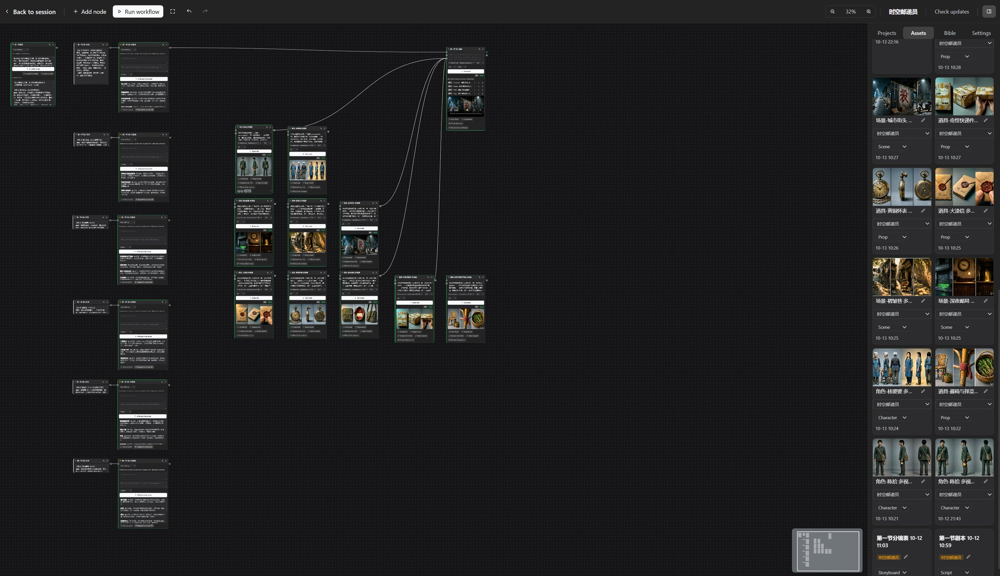

### 3.4 Generate reference images (characters / scenes / props)

**You say:**

> "Generate reference images for every character, scene and prop, following the naming convention."

**The agent**: batch-creates image nodes (`Character-ChenShi multi-view`, `Scene-NightPostOffice multi-view`, `Prop-FireSealLetter multi-view`…) and runs them. Before generating it runs a **consistency check**: entities that appear in shots but aren't registered (or have empty descriptions) raise warnings, and the agent fills the bible first.

Generated assets land in the **Assets** tab, organized by category (Character / Scene / Prop / Script / Storyboard / Voice / Final cut):

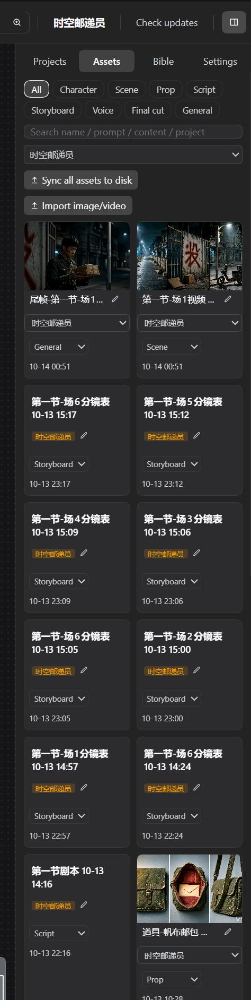

> 💡 Batch tip: ten reference images and six storyboards are exactly the kind of repetitive work the chat side is fastest at — one sentence does it all; you just review the images.

### 3.5 Storyboard + references → scene video

**You say:**

> "Generate scene 1's video."

**The agent**:

1. Reads scene 1's shot list from the storyboard (the shot sequence comes from there, never invented);
2. Creates a video node wired to the storyboard — all shots (order + durations) compose ONE prompt and the video model renders the whole clip in one call (hard cuts by the model);
3. Wires the scene's reference assets to the video node's reference port (`[图1] Character-ChenShi, [图2] Scene-CityStreet…`); `@mentions` in the prompt attach their assets automatically;
4. Runs and polls; when done it **extracts the tail frame** onto the `last` port — scene 2 chains via tail-frame → first-frame for visual continuity.

Scene 1's result: the video node with preview, bound references, and the tail-frame asset (the Assets panel gains "Ep1-Scene1 video" and "tail frame" cards):


### 3.6 Post-production with the Craft family

With the companion [ArtCraft](../dsh-artcraft/README.md) plugin installed, the canvas works with the local Craft suite (12 apps: PhotoCraft imaging / FilmCraft editing+render / SoundCraft audio…):

- **You say:** "Export scenes 1–6 to FilmCraft as an MP4 in order, subtitles from the shot dialogue."
- The final-cut node writes a **FCP7 XML timeline + SRT subtitles** into the data root's `craft/` folder — FilmCraft opens and renders;
- Single assets go to PhotoCraft for grading in one click; the Settings Craft card shows 12 status lights (12/12 ready in the screenshots).

### 3.7 The whole flow

```
chat:  world view/bible → episode script → expand to scenes → batch refs → per-scene videos → craft post
canvas: project card     script node      text+storyboard ×N   ref image nodes ×N   video nodes ×N   craft/ output
```

---

## 4. Manual fine-tuning: nodes are the workbench

After the chat batch is done, the canvas is where you polish:

- **Regenerate**: edit the prompt/idea on a node and hit generate again;
- **Swap references**: the video node's reference list supports reorder (↑↓), remove, and re-attach from the asset page;
- **Parameters**: per-scene duration (≤15s), ratio (16:9/9:16…), resolution (720P/1080P) switch right on the node;
- **Mask inpainting**: image nodes support brush-mask partial redraw;
- **History**: each media node keeps the last 8 results — click a thumbnail to roll back;
- **Re-wire**: unhappy with a scene's storyboard? Wire its text node to another storyboard and re-break.

**Recommended rhythm**: let chat finish the 80% batch → polish the 20% you care about on the canvas → have chat re-run the changed parts.

Shortcuts and gestures:

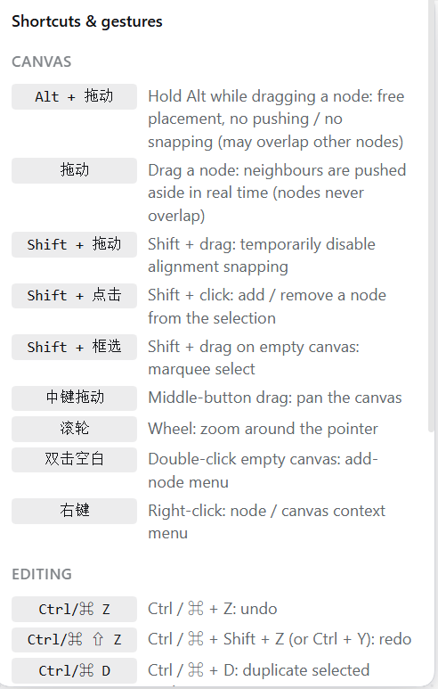

---

## 5. Model configuration: providers + models

Settings tab → Image models / Video models / TTS voices, organized in **two levels**:

1. **Provider** (collapsed row): configure the endpoint + API key **once** (+ optional extra params);
2. **Models**: list several model IDs under it (same vendor, different tiers); **star ★ one as the default** — nodes without an explicit pick route there automatically.

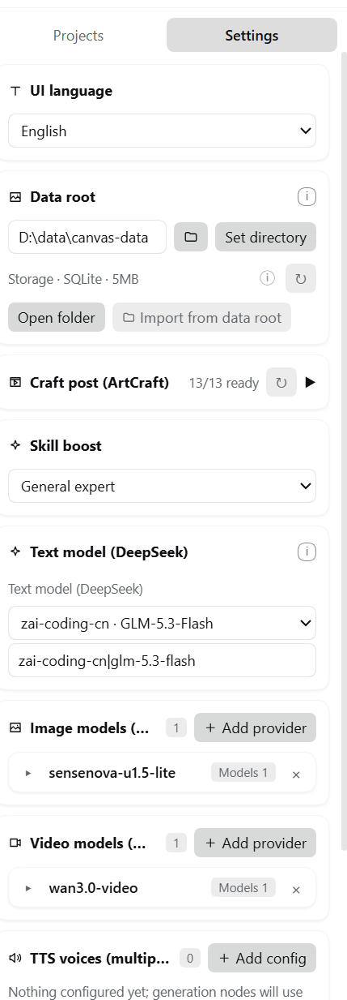

Expand a provider to edit its details (endpoint, key, output format, extra params, model list):


Key points:

- **Fill the endpoint any way you like**: bare domain (`https://api.xxx.com`), up to `/v1`, or the full endpoint — the canvas normalizes it;
- **Extra params (JSON, optional)**: vendor-specific keys (`watermark`, `prompt_extend`, `output_format`, `seed`…) merge into the request body last — switching vendors needs zero code;
- **Node model dropdowns** list every configured model (starred ones carry ★); empty = the starred default; with nothing configured, a run fails with a clear error;
- **Compatibility**: OpenAI-style task APIs, Seedance-native `content[]` and Sora-style `/v1/videos` are auto-detected with a fallback chain; resolution/ratio/first-frame/references are mapped to each vendor's conventions;
- **Text models** use whatever Harness has configured — no extra keys;
- **TTS voices**: same provider structure, mixed into the final cut per shot.

---

## 6. Data root: setup & cross-machine migration

### 6.1 Set the data root

Settings tab → **Data root**: enter a local folder (e.g. `D:\model\canvas-data`) → **Set directory**. Everything is persisted per **project name**:

```
<data root>/
├─ canvas.meta.json          # project id → folder mapping
└─ projects/
   └─ Time-Postman/
      ├─ project.json        # canvas doc (nodes/edges/bible)
      ├─ assets.json         # asset index
      ├─ image/  video/  audio/  text/   # media by type
      └─ craft/              # Craft post-production output (XML/SRT/MP4)
```

**Open folder** opens it in Explorer; **Import from data root** merges disk projects into the canvas in one click.

> Tip: put the data root inside a **cloud-sync folder** (OneDrive/Nutstore/…) and multiple machines stay in sync automatically.

### 6.2 Copying to another machine

1. **Old machine**: copy the whole data root to a USB drive / cloud folder;
2. **New machine**: install the plugin → point Settings → Data root at the copied folder → **auto-recognized**, existing projects appear in the project list;
3. For any browser-local leftovers, click **Import from data root** to merge.

Media lives on disk, organized by project — **copying the folder IS the full migration** (images, videos, audio, scripts and the bible included).

---

## 7. Assets & the bible

### Assets tab

- Everything generated or imported — images, videos, audio, text — in one place; filter by category: All / Character / Scene / Prop / Script / **Storyboard** / **Voice** / **Final cut** / General;
- Each asset card: project dropdown (editable), category dropdown (editable), rename (✎), creation time;
- **Sync all assets to disk**: flush every browser-held asset to the data root;
- **Import image/video**: bring local files in as assets (e.g. a character's line clipped in an NLE);
- Deleting an asset **also deletes the file on disk**.

### Series bible

- One per project: world view / style baseline / characters / scenes / props; "✦ Draft bible with AI" fills it in one click;
- **Injected into everything**: every script, storyboard, image and video call carries it — cross-shot, cross-episode consistency;
- **Bind assets to entities** (📷 button): give "Chen Shi" his multi-view sheet + voice reference, and `@Chen Shi` carries them automatically;
- **Consistency warnings**: unregistered entities appearing in storyboards raise warnings that the agent resolves (names verbatim).

### Voice references (character voice consistency)

1. Check "generate synced audio" on the video provider → generated clips carry their own audio track;
2. On a video/final-cut node click **"Extract voice reference"** → type the character name → every dialogue window is located automatically from the storyboard `dialogue` annotations and merged into one `Character-<name> voice` audio asset (auto-bound to the entity);
3. From then on, `@<name>` in that character's video prompts attaches the voice reference (`audios[]`) and the generated speech aligns to it.

---

## 8. 3D Director Stage

A blocking & previz workspace inside the same project. Place real glTF characters and set dressing, frame them with real cameras, and send the result back to the canvas as an image or video node.

Open it from the left icon rail → **3D Director Stage**.

### 8.1 Workspace map

| Area | What it does |
|---|---|
| **Left tool rail** | Select (0) / Move (1) / Rotate (2) / Scale (3) / Drop to ground (G) / Focus / Upload |
| **Asset library** | Tabbed and searchable: characters · trees · furniture · buildings · primitives |
| **Viewport** | Studio or final look, object labels, move/rotate/scale gizmo, shortcut overlay |
| **Camera PiP** (top right) | Live view of the active camera; switch cameras from here |
| **Right panel** | Context-sensitive: object properties when something is selected, lens/shot settings when nothing is selected, render settings in Live render |
| **Timeline** (Dynamic previz / Live render) | Scrub, shot rail, per-shot start/end, keyframe tools, zoom |

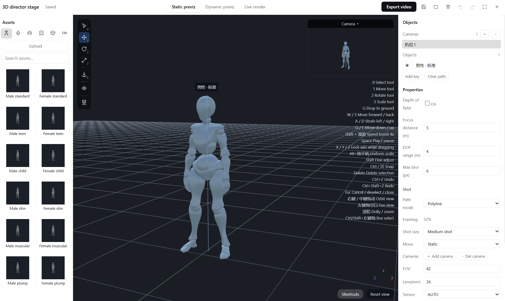

### 8.2 Three viewing modes

| Mode | Look | Playback |
|---|---|---|
| **Static previz** | Studio: dark backdrop, grid, neutral two-light rig | Paused — for blocking |
| **Dynamic previz** | Same fixed studio look | Timeline playback |
| **Live render** | Final look: daylight, shadows, materials, no guides | Plays the shot sequence |

Static and Dynamic deliberately keep a **fixed studio look**, so placement does not drift when you tune the sun, ground or exposure. Those render settings apply only to **Live render** and the exported clip.

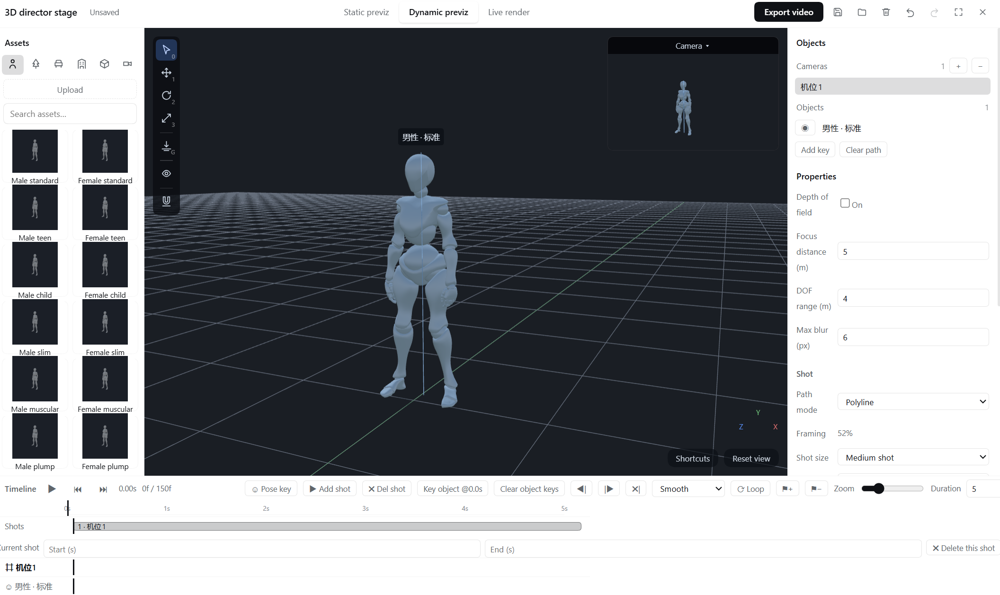

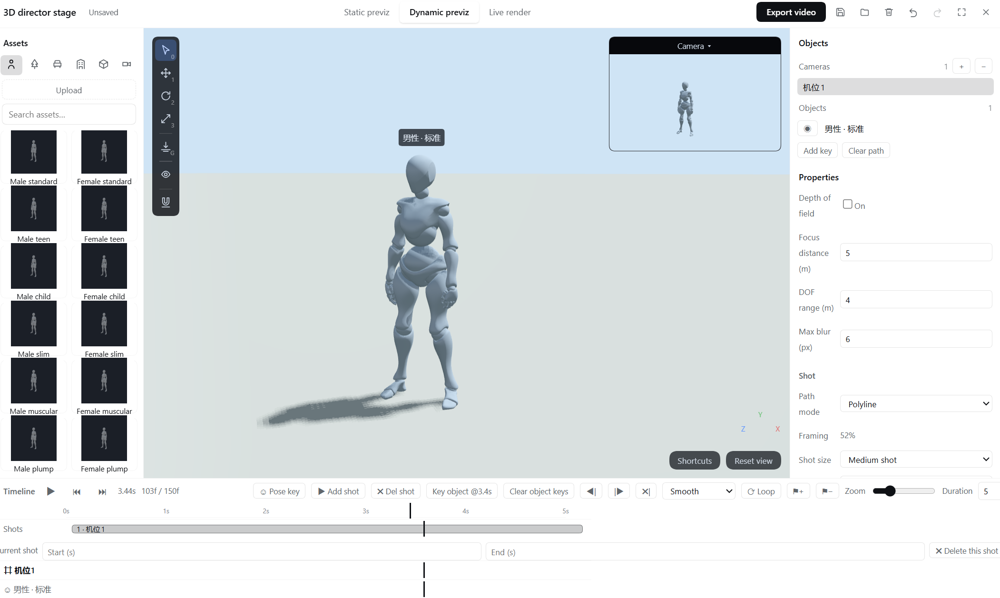

### 8.3 Asset library

Five tabs share one search box. Click an asset to drop it into the scene; characters are real skinned glTF assets with animation clips (idle / walk / run / sneak).

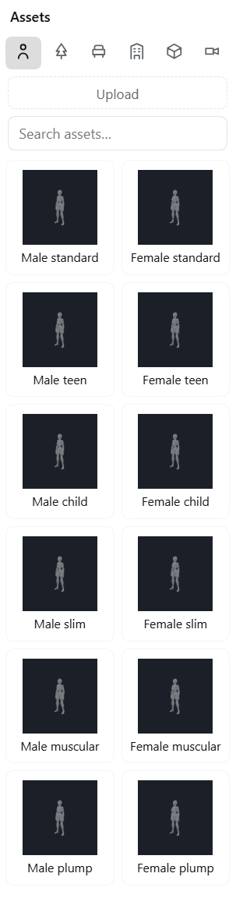

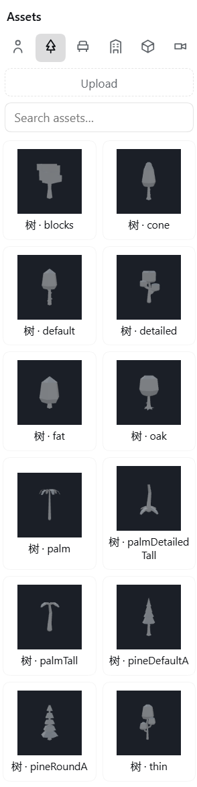

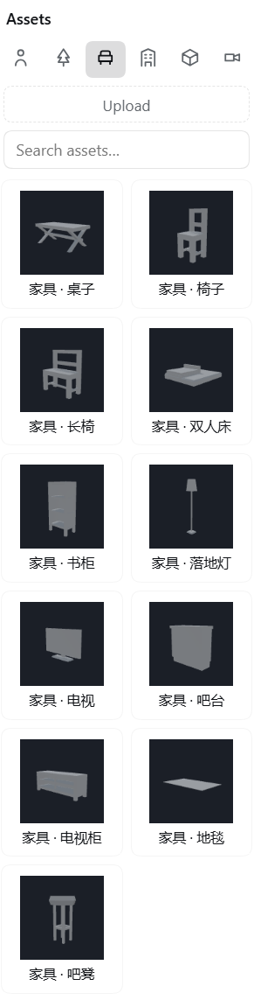

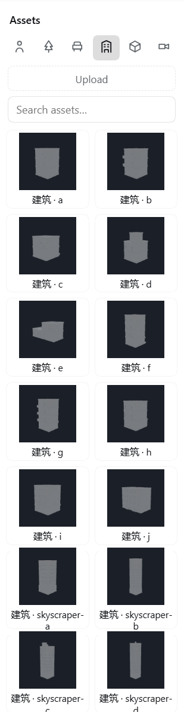

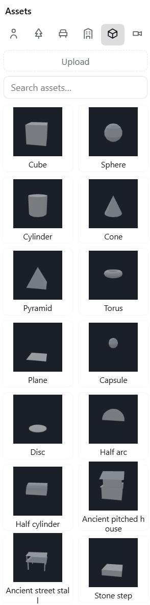

### 8.4 Moving things

- **Gizmo**: axis shafts move, axis-end cubes scale, rings rotate. It follows the object's local axes.
- **Alt + drag a scale handle** = uniform scale — x/y/z keep their relative proportions.
- **Shift** while dragging = fine adjust; **Ctrl/⌘** = snap (0.5 m / 5°).
- **Ctrl/⌘/Shift + left-drag** = box select; a plain click toggles a single object.
- **W/A/S/D + Q/E** = fly the camera (forward/back, strafe, down/up). Hold **Shift** for 4x speed; the mouse still looks around.

### 8.5 Shots, timeline and cameras

- **Shot rail**: every shot has a start and end; edit them under the timeline.
- **Camera keyframes**: select a camera, move it, then press **Add key**. Ease can be Smooth / Linear / Constant.
- **Shot size and move**: presets that also drive the camera distance; **Framing %** shows how much of the subject fills the frame.
- **Lens**: FOV, focal length and sensor size stay consistent; roll is in degrees.

### 8.6 Export

**Export video** renders the current range at 1280×720 with the same renderer as Live render, then drops the clip back on the canvas as a **video node**. The camera button exports a single **PNG** as an image node. Encoding follows the browser: MP4 (H.264) when available, WebM otherwise.

---

## 9. Craft page: four-layer console

The third tab of the right sidebar — **Craft** — decides **how the whole piece is shot**. It is not a prompt template: it is a binding constraint composed into every script, storyboard, image and video generation.

There are **no dropdowns** on the page. Every option is an icon tile: click to select, click again to clear.

### 9.1 What each layer owns

| Layer | Count | Decides | Why it needs its own layer |
|---|---|---|---|
| **Director** | 24 | Camera language, lighting, cutting rhythm, style parameters | It constrains the shot's camera fields, the keyframe and the video's camera move at once — the least replaceable decision in the whole piece |
| **Genre** | 21 narrative / 10 sector | Pressure mechanics, audience payoff, scene granules, episode hooks | The same "revenge" premise is fragmented neon under Wong Kar-wai and hard-lit slow motion under Tsui Hark; folding them together poisons both |
| **Delivery form** | 8 | Structure blocks, ASL floor, rhythm, quality bar | It decides "short drama vs cinematic texture vs commercial", which is orthogonal to genre |
| **Look** | 9 | Imaging base, material, render texture | 2D thick paint / guoman 3D / game CG are imaging domains, not directors |

**Eight delivery forms**: Short drama · Cinematic texture · Commercial · Documentary · Music video · Trailer · Explainer · Interview.

- A **short drama** is a self-contained 60–180 s unit and **covers both single episodes and multi-episode series** — a series is just episode after episode, so there is no separate "series" form. Its quality bar is "shoot it like film", not "shoot it like a short video".
- **Cinematic texture** is a *texture* spec, not a feature-length one. It constrains how each shot must be made to read as cinema (ASL floor 1.5 s, 24 fps, motivated light, real materials, readable depth), and its duration tiers stop at 30–300 s. The reason is practical: **a video model emits only 3–8 s per clip** (5 s by default here), so "a 120-minute film" can only be hundreds of clips stitched together — a 120-minute tier in the spec would be fiction. For a feature, advance episode by episode; this spec makes each segment pass the cinema line.
- **Commercial** merges 宣传片 (brand film) / 广告片 (ad) / 产品片 (product film) into one card — near-identical needs, split internally by block ratios instead of three cards.

The genre layer **switches automatically with the delivery form**: pick Commercial and it shows sector cards (tech, finance, medical, beauty, auto, education, FMCG, travel, real estate, food); every other form shows narrative genres.

**Priority**: explicit user instruction > director > delivery form (only on ASL and structure) > genre > look.

### 9.2 Aspect ratio is not decided here

Vertical, horizontal, square or widescreen all work with any delivery form — **aspect and resolution are chosen on the video node at generation time**. Vertical delivery is common for short drama, but that is a distribution choice, not a craft spec; **a short drama can equally be shot horizontal and to a cinematic standard**. The delivery form constrains **structure, rhythm and quality bar**, not proportion.

### 9.3 Three buttons

- **Preview** — shows the assembled slice and its byte size, so you can confirm what actually goes in
- **To bible** — writes the style summary (director + genre + form + look) into the bible's style field; the chat side reads it from there
- **Clear** — resets all four layers; generation falls back to the previous behaviour

### 9.4 Configuration is per project

One piece, one configuration. It is stored **on the project document** (same sync mechanism as the series bible), so the chat side reads the same selection the panel shows, and switching projects switches the craft page with it. **Existing projects have no such field and fall back to defaults — generation behaves exactly as before.**

### 9.5 Using it from the chat

Say "shoot this in Wong Kar-wai's style" and the agent will:

1. call `canvas_list_skills` to see the plugin's four skills, the full four-layer inventory, and the current project selection;
2. call `canvas_skill_pack({ projectId, kind })` to pull the matching slice (`script` / `storyboard` / `prompt` / `assets`);
3. write against that slice — **the same slice the canvas itself uses**.

You can also have the agent change the configuration in chat (it passes `set: true` to persist it); the panel syncs on refresh.

### 9.6 Where it is injected

| Node / capability | What it receives |
|---|---|
| Script node | Genre cards + the lens's narrative/rhythm/performance sections + the form's structure blocks |
| Storyboard node | The lens's camera language, lighting, style parameters and shot checklist + the form + the camera-move dictionary |
| Image node | A style lock: style parameters + look imaging/material + genre granules + three negative lists |
| Video node | Same (also appended when an upstream storyboard feeds it, without breaking the structured format) |
| Character/scene/prop sheets | The lens's lighting and colour + the look card |
| Bible AI draft | Same as script |

**With all four layers empty nothing is injected.**

---

## 10. Troubleshooting


| Symptom | Cause & fix |
|---|---|
| Video fails with HTTP 413 | References too large — fixed since 0.17.11 (auto 1024px JPEG downscale); upgrade |
| Video 404 / "Unsupported model type" | The gateway endpoint doesn't serve that model's channel: verify the endpoint URL and model ID (copy from the platform's model list); some platforms also need the right **token group**; the canvas automatically falls back to Seedance-native `content[]` and `/v1/videos` |
| Video 503 supply unavailable | The platform's model supply is temporarily down — retry later |
| Deleted nodes come back | Old sync race — upgrade to 0.17.11+ |
| Storyboards always have exactly 6 shots | Old anchoring issue — since 0.17.11 shot counts follow the content beats |
| Demo-mode images | No model configured, or the node has no pick and no starred default — see section 5 |

Stuck? Open **Help & feedback** from the right panel to join the group or file an issue:

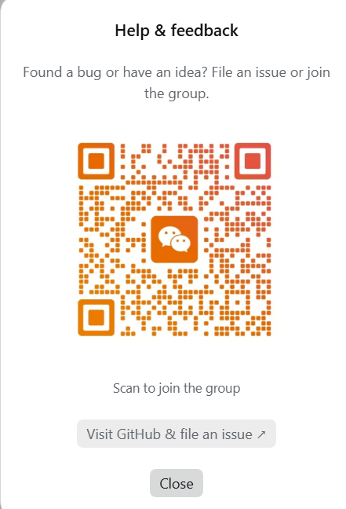
