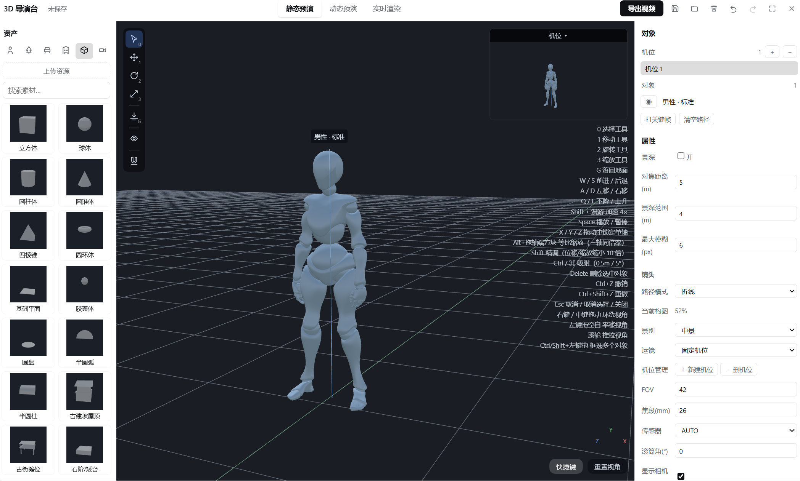
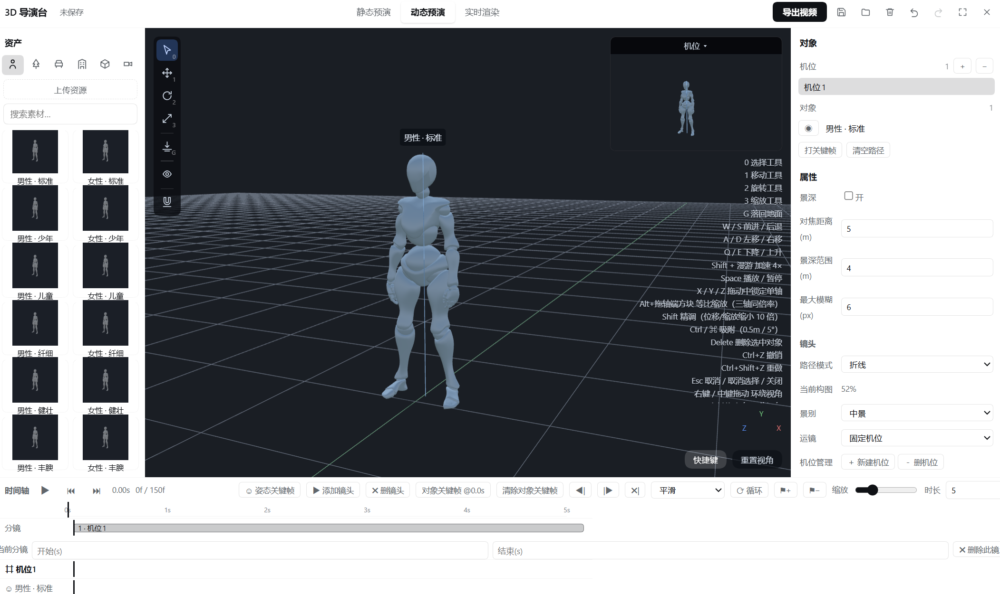
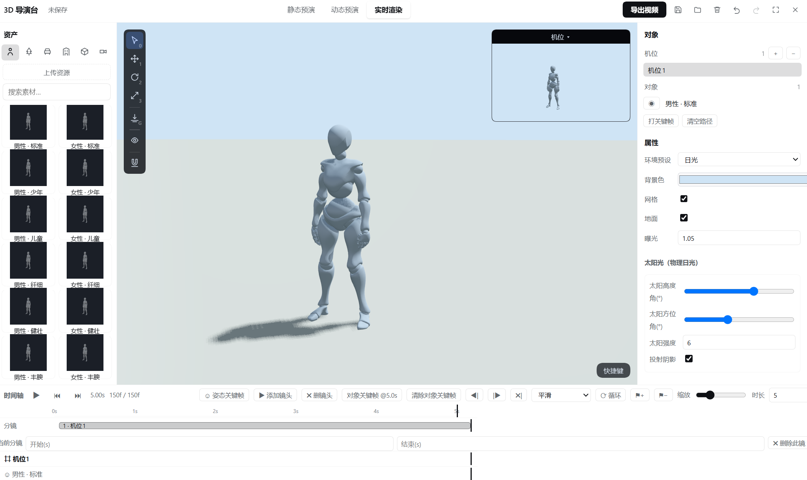
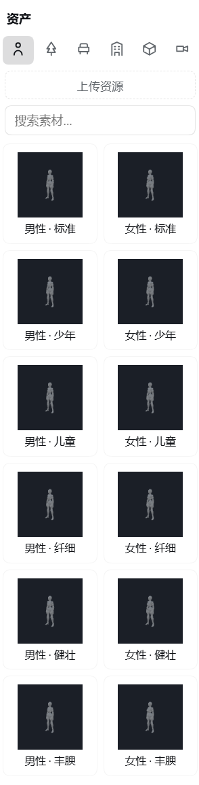
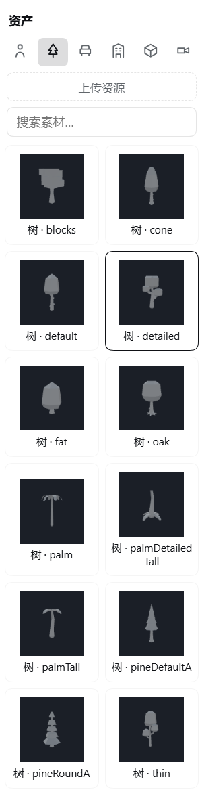
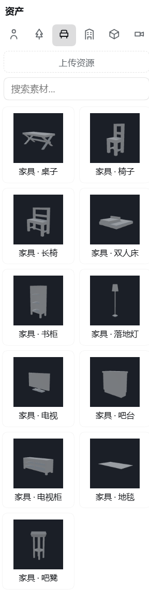
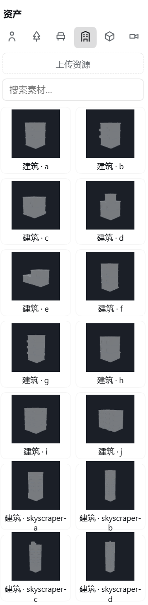
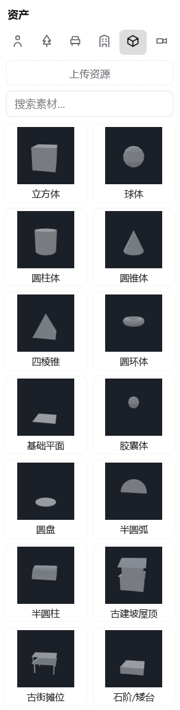

# 无限画布操作手册 —— 以《时空邮递员》为例

> **English guide: [guide.en.md](./guide.en.md)**（英文版为主）
> 本手册以示例项目《时空邮递员》贯穿全程，截图均来自真实制作过程（当前版本界面）。
> 核心理念一句话：**批量工作交给 Harness 对话，细节自己在画布上调。**

---

## 1. 这是什么

无限画布是 DeepSeek Harness 的插件：把侧边栏变成"节点式短剧工作室"。剧本、设定集、分镜、资产图、视频、成片全部以**节点**摆在无限画布上，连线组成流水线。

两种驱动方式，配合使用效率最高：

| 方式 | 适合做什么 |
|---|---|
| **Harness 对话驱动**（推荐主力） | 批量与流程性工作：出世界观、写整集剧本、铺开分镜、批量生成参考图、逐场生成视频——一句话，Agent 调用画布工具批量完成 |
| **画布手动操作**（精修） | 个别结果不满意时：节点上直接改提示词重新生成、调时长/比例、拖参考图顺序、回退历史版本 |

---

## 2. 准备工作

1. 安装插件（bundle 目录）后**重启一次 Harness**，进入工作区会话，侧边栏/工具栏出现**无限画布**入口。
2. 点开画布面板，右侧是四个页签：**项目 / 资产 / 设定集 / 设置**。


3. 首次使用先到**设置**页签完成基础配置（见第 5 节），回到对话即可开工。

### 2.1 让画布停在对话旁边（右栏页签）

不想在「对话」和「画布」两个视图之间来回切：画布也能作为 **Harness 右侧面板的一个页签**打开，左边对话、右边分镜同屏工作。

1. 打开右侧面板（标题为**开始**）。
2. 点 **无限画布** 卡片 → 画布作为页签出现在对话右侧，与全屏面板共享同一批项目/节点/资产。
3. 把右栏拖宽，或用右栏的全屏按钮，可获得更大画布区域。


> **同一时刻只有一个画布实例**（共享节点图与生成状态）。若全屏面板也开着，在右栏打开会把画布**移动**过来而不是复制一份，另一侧显示「把画布切换到这里」按钮；点它即可切回去。

---

## 3. 核心：用对话驱动画布（以第一集完整制作为例）

### 3.1 出世界观、写设定集

**你说：**

> 「用【时空邮递员】做示例项目，先出世界观和设定集。」

**Agent 做的事**：创建项目 → 把世界观、风格基调、角色（陈拾/林婆婆）、场景（深夜邮局/褶皱巷/城市街头）、道具（火漆信/黄铜怀表/帆布邮包…）逐条写入**设定集**。


**为什么设定集重要**：它是跨镜、跨集一致性的唯一事实源——之后每次剧本生成、分镜拆解、视频生成都自动注入设定集；提示词里 `@陈拾` 这样的引用会自动携带该实体的设定描述与参考图资产，**不需要在每个提示词里重复描述人物长相**。

> 💡 批量提示：「把所有角色/场景/道具的设定补全到可直接生成的程度」——纯批量填表工作，交给对话远快于手动。

### 3.2 写剧本（一集 = 60–120 秒成片）

**你说：**

> 「根据设定集写第一集剧本《深夜邮局的绿灯》。」

**Agent 做的事**：创建「第一节剧本」节点并触发生成。剧本自动满足：一集 1–2 分钟、4–10 场、**每场以「【场N】场景名（地点·时间）」单独一行开头**（下一步自动铺开的解析标记）、每场 10–15 秒容量、对白逐行「角色：台词」。

### 3.3 铺开到场景

点剧本节点的**「铺开到场景」按钮**，或对 Agent 说「把第一集铺开到场景」。画布上自动出现每场一组的节点组合：

```
第一节-场1文本 ──→ 第一节-场1分镜表
第一节-场2文本 ──→ 第一节-场2分镜表
……（每场一条连线，一次生成一个 10–15s 的场景视频）
```

分镜表由 AI 拆解为镜头清单：每镜含画面、动作与运镜、角色/场景/道具（`@名称` 引用）、时长、**台词标注**（哪句台词属于哪个角色——后面提取声音参考就靠它）。镜头数量按内容节拍自然决定，全部镜头时长之和 ≤ 15 秒。

整集铺开后的画布（左侧：剧本 → 各场文本 → 各场分镜表的连线组）：


场1 的连线细节（场1文本 → 场1分镜表 → 场1视频）：


### 3.4 生成资产图（角色/场景/道具参考图）

**你说：**

> 「把设定集里的所有角色、场景、道具都生成参考图，按命名规范。」

**Agent 做的事**：批量创建图片生成节点（`角色-陈拾 多视图`、`场景-深夜邮局 多视图`、`道具-火漆信 多视图`…），逐个触发生成。生成前自动做**一致性检查**：分镜里出现但设定集未登记（或描述为空）的实体会产生告警，Agent 先补全设定再生成。

生成完的资产进入右侧**资产页签**，按分类（角色/场景/道具/剧本/分镜表/配音/成片）归档：


> 💡 批量提示：10 张参考图、6 个分镜表这类重复性批量工作是对话驱动的最大收益点——一句话全做完，你只检查画面细节。

### 3.5 分镜 + 资产图 → 生成场景视频

**你说：**

> 「生成场1的视频。」

**Agent 做的事**：

1. 读取场1分镜表的镜头清单（镜头序列以此为准，不自行编造）；
2. 创建视频生成节点并连线分镜表——全部镜头按顺序+时长合成一条提示词，**视频模型一次性生成整段**（镜头间硬切）；
3. 把本场参考图连到视频节点参考端口（`[图1] 角色-陈拾、[图2] 场景-城市街头…`），提示词里的 `@引用` 也会自动挂载；
4. 触发生成并轮询；完成后自动**提取尾帧**挂到 `last` 端口——场2 用「尾帧 → 首帧」串联，保证段间画面连贯。

场1 的成品：视频节点带预览、参考图绑定、尾帧资产（右侧资产页同时出现「第一节-场1视频」与「尾帧」卡片）：


### 3.6 调用 Craft 家族做后期

安装 [ArtCraft](../dsh-artcraft/README.md) 插件后，画布与本地 Craft 家族（12 个：PhotoCraft 修图 / FilmCraft 剪辑渲染 / SoundCraft 音频…）协作：

- **你说：**「把场1到场6按顺序导出给 FilmCraft 渲染 MP4，字幕用分镜台词。」
- 成片节点写出 **FCP7 XML 时间线 + SRT 字幕**到数据目录 `craft/` 文件夹，FilmCraft 打开即渲染；
- 单张资产图一键交 PhotoCraft 调色；设置页 Craft 卡片显示 12 盏状态灯（12/12 就绪）。

### 3.7 流程总览

```
对话：出世界观/设定集 → 写第一集剧本 → 铺开到场景 → 批量资产图 → 逐场视频 → craft 成片
画布：  项目卡片        剧本节点       文本+分镜表×N    资产图节点×N    视频节点×N     craft/ 产物
```

---

## 4. 手动微调：节点就是工作台

对话批量跑完后，画布是你精修的地方：

- **重新生成**：改节点上的提示词/创意，再点一次生成；
- **换参考图**：视频节点的参考图列表可排序（↑↓）、删除、从资产页补挂；
- **调参数**：每场视频的时长（≤15s）、比例（16:9/9:16…）、分辨率（720P/1080P）节点上直接切；
- **蒙版重绘**：图片节点支持涂抹蒙版局部重绘；
- **历史版本**：每个媒体节点保留最近 8 次结果，点缩略图即回退；
- **拖拽重连**：不满意某场分镜？把文本节点连到另一个分镜表重新拆。

**推荐节奏**：对话干完 80% 批量活 → 画布上精修不满意的 20% → 再让对话批量重跑改过的部分。

快捷键与操作：


---

## 5. 模型配置：供应商 + 模型

设置页签 → 图片模型 / 视频模型 / TTS 配音，采用**两级结构**：

1. **供应商**（折叠行）：**一个供应商只配一次**接口地址 + API Key（+ 可选扩展参数）；
2. **模型**：供应商下挂多个模型 ID（同厂不同等级），**点 ★ 星标 = 默认模型**——节点上没选模型时自动路由到这里。


展开某个供应商即可编辑详情（地址、Key、输出格式、扩展参数、模型列表）：


要点：

- **接口地址怎么填都行**：裸域（`https://api.xxx.com`）、填到 `/v1`、或完整端点，画布自动归一化；
- **扩展参数（JSON，可选）**：厂商专属参数（`watermark`、`prompt_extend`、`output_format`、`seed`…）逐键合并进请求体，**换厂商零代码**；
- **节点上的模型下拉**直接列出所有已配置模型（星标带 ★）；留空 = 用默认模型；一个模型都没配时运行明确报错；
- **兼容性**：OpenAI 风格任务接口、Seedance 原生 `content[]`、Sora 风格 `/v1/videos` 自动识别与降级；分辨率/比例/首帧/参考图按厂商惯例自动转换；
- **文本模型**直接使用 Harness 当前配置的模型，无需额外 Key；
- **TTS 配音**：同一供应商结构，按镜配音混入成片。

---

## 6. 数据目录：设置与跨电脑迁移

### 6.1 设置数据目录

设置页签 → **数据根目录**：填本地文件夹路径（如 `D:\model\canvas-data`）→「设置此目录」。设置后所有项目数据按**项目名**落盘：

```
<数据根目录>/
├─ canvas.meta.json          # 项目 ID → 文件夹 映射
└─ projects/
   └─ 时空邮递员/
      ├─ project.json        # 画布文档（节点/连线/设定集）
      ├─ assets.json         # 资产索引
      ├─ image/  video/  audio/  text/   # 媒体文件（按类型分目录）
      └─ craft/              # Craft 家族后期产物（XML/SRT/MP4）
```

「打开目录」可直接在资源管理器中打开；「从数据目录导入」一键把磁盘上的项目合并进画布。

> 建议把数据目录放进**网盘同步文件夹**（OneDrive/坚果云等），多台电脑自动同步。

### 6.2 跨电脑复制导入

1. **旧电脑**：整个数据根目录复制到 U 盘/网盘；
2. **新电脑**：安装插件 → 设置页签把数据根目录指向复制来的文件夹 → **自动识别**，已有项目直接出现在项目列表；
3. 浏览器本地若有零散未落盘数据，点 **「从数据目录导入」** 一键合并。

媒体文件全部在磁盘上、按项目名组织——**复制目录 = 完整迁移**（含所有图片、视频、音频、剧本文本与设定集）。

---

## 7. 资产管理与设定集

### 资产页

- 所有生成/导入的图片、视频、音频、文本集中管理；顶部分类筛选：全部 / 角色 / 场景 / 道具 / 剧本 / **分镜表** / **配音** / **成片** / 通用；
- 每张资产卡：项目归属下拉（可改）、分类下拉（可改）、编辑名（✎）、生成时间；
- **「同步全部资产到磁盘」**：把浏览器里的历史资产一次性落盘到数据目录；
- **「导入图片/视频」**：把本地文件导入为资产（如剪辑软件里剪出的角色台词片段）；
- 删除资产会**同步删除磁盘文件**。

### 设定集（Series Bible）

- 每项目一份：世界观 / 风格基调 / 角色 / 场景 / 道具；「✦ AI 起草设定集」一键起草；
- **注入一切生成**：剧本、分镜、图片、视频的每次 AI 调用都携带设定集，保证跨镜跨集一致；
- **实体绑定资产**（📷 按钮）：给「陈拾」绑定他的多视图图 + 声音参考，`@陈拾` 自动携带；
- **一致性告警**：分镜里出现未登记实体时产生告警，Agent 自动补全（名称逐字一致）。

### 声音参考（角色音色一致性）

1. 视频供应商勾选「生成同步音频」→ 生成自带音轨的视频；
2. 视频/成片节点点「**提取声音参考**」→ 输入角色名 → 自动按分镜台词标注定位该角色全部台词时间窗，拼接为一个 `角色-<名> 声音` 音频资产（自动绑定实体）；
3. 之后该角色的视频提示词 `@<名>` 自动携带音色参考，模型生成的对白向参考音色对齐。

---

## 8. 3D 导演台

同一项目里内置的摆位与预演工作台。把真实 glTF 角色与场景陈设摆进场景，用真实机位取景，再把结果作为图片或视频节点导回画布。

入口：左侧图标列 → **3D 导演台**。

### 8.1 界面分区

| 区域 | 作用 |
|---|---|
| **左侧工具列** | 选择(0) / 移动(1) / 旋转(2) / 缩放(3) / 落地(G) / 聚焦 / 上传 |
| **资产库** | 页签 + 搜索：人物 · 树木 · 家具 · 建筑 · 几何体 |
| **视口** | 影棚或成片外观、对象名称标签、移动/旋转/缩放操作轴、快捷键浮层 |
| **机位缩略图**（右上） | 当前机位的实时画面；也可在这里切换机位 |
| **右侧面板** | 随上下文变化：选中对象时是对象属性；未选中时是镜头/机位设置；实时渲染下是渲染参数 |
| **时间轴**（动态预演 / 实时渲染） | 拖动播放头、分镜轨、单镜起止、关键帧工具、缩放 |



### 8.2 三种观看模式

| 模式 | 画面 | 播放 |
|---|---|---|
| **静态预演** | 影棚：深色背景、网格、中性双灯 | 暂停，用于摆位 |
| **动态预演** | 同样是固定影棚外观 | 时间轴播放 |
| **实时渲染** | 成片外观：日光、阴影、材质，无辅助线 | 播放整段分镜 |

静态/动态刻意保持**固定影棚外观**，这样你调太阳、地面、曝光时，摆位画面不会跟着漂移；这些渲染参数只影响**实时渲染**和导出的成片。





### 8.3 资产库

五个页签共用一个搜索框。点一下资产即可放入场景；人物是真实的骨骼 glTF 资产，带待机/行走/奔跑/潜行等动画片段。











### 8.4 移动与操作

- **操作轴**：轴身拖动=移动，轴端方块=缩放，圆环=旋转；轴跟随物体的局部朝向。
- **Alt + 拖轴端方块**：等比缩放，x/y/z 保持原有比例。
- **拖动时按 Shift**：精调；按 **Ctrl/⌘**：吸附（0.5m / 5°）。
- **Ctrl/⌘/Shift + 左键拖动**：框选；只点一下则是增删单个对象。
- **W/A/S/D + Q/E**：键盘漫游（前进/后退、左右平移、下降/上升）；按住 **Shift** 加速 4 倍，鼠标仍负责转向。

### 8.5 分镜、时间轴与机位

- **分镜轨**：每个分镜有起止时间，可在时间轴下方直接改。
- **机位关键帧**：选中机位 → 移动相机 → 点「添加关键帧」；缓动可选平滑 / 线性 / 恒定。
- **景别与运镜**：预设会同时调整机位距离；「当前构图」显示主体占画面的百分比。
- **镜头**：FOV、焦段、传感器尺寸三者联动一致；滚筒角以度为单位。

### 8.6 导出

**导出视频**用与实时渲染同一套渲染器，按当前区间输出 1280×720，再作为**视频节点**落回画布；相机按钮导出单帧 **PNG** 作为图片节点。编码取决于浏览器能力：支持时输出 MP4（H.264），否则 WebM。

---

## 9. 技能页：四层创作控制台

右栏第三个页签「技能」决定**整部片怎么拍**。它不是提示词模板，而是会被自动拼进每一次剧本、分镜、图片、视频生成的硬约束。

页内**没有任何下拉框**，全部是图标瓦片：点一下选中，再点一下取消。

### 9.1 四层各管什么

| 层 | 数量 | 决定 | 为什么单独一层 |
|---|---|---|---|
| **导演** | 24 | 镜头语言、灯光色彩、剪辑节奏、风格参数 | 它同时约束分镜的机位字段、图片关键帧、视频运镜——整部片最不可替换的决策 |
| **题材** | 叙事 21 / 行业 10 | 压力机制、观众回报、场面颗粒、集尾钩子 | 同一个「复仇打脸」，王家卫拍是抽帧暧昧，徐克拍是凌厉升格；混进导演层会互相污染 |
| **规格** | 8 | 结构块、平均镜长下限、节奏、质量档 | 它决定「这是短剧、电影还是商业片」，与题材正交 |
| **影调** | 9 | 成像底层、材质、渲染质感 | 2D 厚涂 / 国漫 3D / 游戏 CG 是成像域，不是导演；塞进导演会让「怎么剪」和「长什么样」打架 |

**八种规格**：短剧 · 电影质感 · 商业片 · 纪实 · 音乐视频 · 预告 · 解说 · 访谈。

其中：
- **短剧**是单集 60–180 秒的自足单元，**同时覆盖单集与连续多集**——一部剧就是一集一集往下做，不需要单独的「连续剧」规格。它对质量的要求是「按电影标准拍」，不是「短视频标准」：真实光源与光比、有依据的焦段、可读的景深。
- **电影质感**是**质感规格，不是长片规格**。它约束每一镜怎么做才像电影（ASL 1.5 秒以上、24 帧、动机光、真材质、成立构图），成片长度档只到 30–300 秒。原因很实际：**AI 视频模型单次只出 3–8 秒**（本插件默认 5 秒），所谓「一部 120 分钟的电影」只能是几百上千个片段接起来，把它写成规格里的一个时长档没有意义。要拍长片，按集/按段推进，本规格负责每一段都过电影线。
- **商业片**把「宣传片 / 广告片 / 产品片」合成一张卡——它们是相近需求，靠段位配比内部分流，不再拆成三张。

**画幅不在这里决定。** 横屏、竖屏、方屏、宽银幕都能用任何规格——**画幅与分辨率是视频节点生成时的选项**。短剧竖屏投放很常见，但那是发行选择，不是创作规格；短剧同样可以横屏、可以按电影标准拍。规格约束的是**结构、节奏、质量档**，不是比例。

题材层会**随规格自动切换**：选「商业片」时换成行业题材（科技、金融、医疗、美妆、汽车、教育、快消、文旅、地产、餐饮）；其余类型显示叙事题材。

优先级：**用户显式指令 > 导演 > 规格（仅单镜时长与结构上压过导演）> 题材 > 影调**。

### 9.2 三个按钮

- **预览**：显示当前配置注入到剧本的切片全文与字节数。用来确认「到底塞了什么进去」。
- **写设定集**：把风格摘要（导演名 + 题材 + 规格 + 影调）写进设定集的「风格基调」，这样对话侧也能读到。
- **清空**：四层全归零，生成行为回到默认。

### 9.3 配置按项目保存

一部片一套配置，存在项目文档里（与设定集同一套同步机制），所以**对话侧读得到、面板上也看得到**。切换项目时技能页跟着切换。**老项目没有这个字段，一律按默认处理，生成行为与之前完全一致。**

### 9.4 对话侧怎么用

在对话框里直接说「用王家卫的风格拍这段」，Agent 会：

1. 调 `canvas_list_skills` 看本插件有哪四份技能、四层卡片各有哪些、当前项目选了什么；
2. 调 `canvas_skill_pack({ projectId, kind })` 取对应切片（`script` / `storyboard` / `prompt` / `assets`）；
3. 按切片写内容——**和画布自己生成用的是同一套口径**。

你也可以在对话里让 Agent 直接改配置（它会带上 `set: true` 写进项目），改完刷新面板即同步。

### 9.5 注入到哪

| 节点 / 能力 | 拿到的切片 |
|---|---|
| 剧本节点 | 题材卡 + 导演的叙事/节奏/表演节 + 规格的结构块 |
| 分镜表节点 | 导演的镜头语言/灯光/风格参数/拍摄清单 + 规格 + 运镜词典 |
| 图片节点 | 只追加「镜头语言锁」：风格参数 + 影调负向词 |
| 视频节点 | 同上（有上游分镜表时也追加，不打断结构化字段） |
| 角色/场景/道具设定图 | 导演的灯光色彩 + 影调卡 |
| 设定集 AI 草稿 | 同剧本 |

**四层全空时什么都不注入**——这是保持不变的行为。

---

## 10. 常见问题

| 现象 | 原因与处理 |
|---|---|
| 视频报 HTTP 413 | 参考图过大——0.17.11 起已自动压缩（1024px JPEG），请升级 |
| 视频报 404 / "Unsupported model type" | 网关端点与模型渠道不匹配：核对接口地址与模型 ID（从平台模型列表复制）；部分平台需检查**令牌分组**；画布会自动降级尝试 Seedance 原生 `content[]` 格式与 `/v1/videos` |
| 视频报 503 supply unavailable | 平台侧模型供货暂时不可用，稍后重试 |
| 删除的节点又出现 | 旧版本同步竞态，升级到 0.17.11+ |
| 分镜只有固定 6 镜 | 旧版锚定问题，0.17.11 起镜头数按内容节拍自动决定 |
| 演示模式出图 | 没配对应模型，或节点上没选且无星标默认——按第 5 节配置 |

遇到问题？右侧面板的 **帮助与反馈** 可以扫码进群或到 GitHub 提 Issue：


