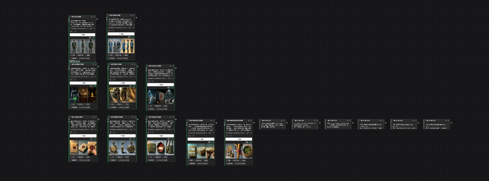
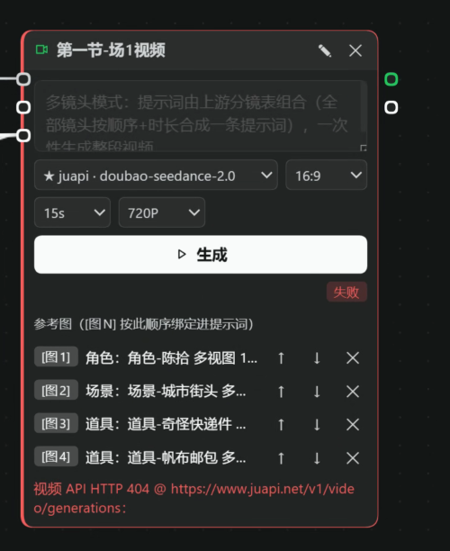
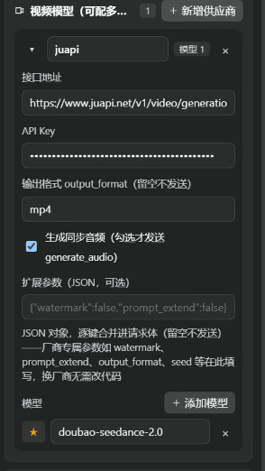
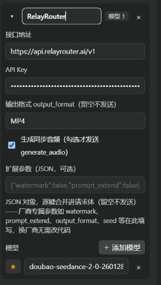

# 无限画布操作手册 —— 以《时空邮递员》为例

> 本手册以示例项目《时空邮递员》贯穿全程，截图均来自真实操作过程。
> 核心理念一句话：**批量工作交给 Harness 对话，细节自己在画布上调。**

---

## 1. 这是什么

无限画布是 DeepSeek Harness 的一个插件：把侧边栏变成一个"节点式短剧工作室"。剧本、设定集、分镜、资产图、视频、成片全部以**节点**的形式摆在无限画布上，节点之间连线组成流水线。

它有两种驱动方式，配合使用效率最高：

| 方式 | 适合做什么 |
|---|---|
| **Harness 对话驱动**（推荐主力） | 批量与流程性工作：出世界观、写整集剧本、拆分镜、批量生成参考图、逐场生成视频——一句话，Agent 调用画布工具批量完成 |
| **画布手动操作**（精修） | 对个别结果不满意时：直接在节点上改提示词重新生成、调时长/比例、拖动参考图顺序、回退历史版本 |

---

## 2. 准备工作

1. 安装插件（bundle 目录）后**重启一次 Harness**，左侧边栏出现 **Infinite Canvas** 按钮。
2. 点击打开画布面板；首次使用建议先到 **设置面板 → 语言/数据目录** 完成基础配置（见第 6 节）。
3. 回到对话，直接说出你想做的项目，例如：

> 「用【时空邮递员】作为示例项目，新建一个画布项目。」

Agent 会调用画布工具创建项目，画布上出现项目卡片。

---

## 3. 核心工作方式：用对话驱动画布

这是本插件最重要的用法。下面用《时空邮递员》第一集的真实制作过程，走一遍完整流程。

### 3.1 出世界观、写设定集

**你说：**

> 「先出世界观和设定集：现代都市奇幻，深夜老邮局藏着时空邮局……」

**Agent 做的事**：创建项目 → 把世界观、风格基调、角色（陈拾/林婆婆）、场景（深夜邮局/褶皱巷/城市街头）、道具（火漆信/黄铜怀表/帆布邮包…）逐条写入**设定集**。

**为什么设定集重要**：它是跨镜、跨集一致性的唯一事实源——之后每一次剧本生成、分镜拆解、视频生成都会自动注入设定集；提示词里 `@陈拾` 这样的引用会自动携带该实体的设定描述与参考图资产。**不需要在每个提示词里重复描述人物长相。**

> 💡 批量提示：让 Agent「把所有角色/场景/道具的设定补全到可直接生成的程度」，它会逐条补写描述——这是纯批量工作，交给对话效率远高于手动填表。

### 3.2 写剧本（一集 = 60–120 秒成片）

**你说：**

> 「根据设定集写第一集剧本《深夜邮局的绿灯》。」

**Agent 做的事**：创建「第一节剧本」节点并触发生成。画布上的剧本节点会流式写出整集剧本，自动满足：

- 成片时长 1–2 分钟，共 4–10 个场景；
- **每个场景以「【场N】场景名（地点·时间）」单独一行开头**（这是下一步自动铺开的解析标记）；
- 每场 10–15 秒容量，对白逐行「角色：台词」。

生成完成后，节点上有「存为资产」「铺开到场景」两个按钮。

### 3.3 铺开到场景

**点剧本节点的「铺开到场景」按钮**，或对 Agent 说「把第一集铺开到场景」。

画布上自动出现**每场一组**的节点组合：

```
第一节-场1文本 ──→ 第一节-场1分镜表
第一节-场2文本 ──→ 第一节-场2分镜表
……（每场一条连线，一次生成一个 10–15s 的场景视频）
```

每个分镜表节点随后由 AI 拆解为镜头清单（shots）：每镜含画面描述、动作与运镜、角色/场景/道具（`@名称` 引用）、时长、**台词标注**（哪句台词属于哪个角色——后面提取声音参考就靠它）。镜头数量按内容节拍自然决定，全部镜头时长之和 ≤ 15 秒。

### 3.4 生成资产图（角色/场景/道具参考图）

**你说：**

> 「把设定集里的所有角色、场景、道具都生成参考图，按命名规范。」

**Agent 做的事**：批量创建图片生成节点（`角色-陈拾 多视图`、`场景-深夜邮局 多视图`、`道具-火漆信 多视图`…），逐个触发生成。生成前 Agent 会先做**一致性检查**：分镜里出现但设定集里没登记（或描述为空）的实体会产生告警，Agent 会自动补全设定再生成。

完成后画布上是整齐的一排资产节点（每张图都是后续视频生成时的"证件照"）：



> 💡 批量提示：10 张参考图、6 个分镜表这类**重复性批量工作是对话驱动的最大收益点**——一句话全做完，你只需要最后检查画面细节。

### 3.5 分镜 + 资产图 → 生成场景视频

**你说：**

> 「生成场1的视频。」

**Agent 做的事**：

1. 读取场1分镜表的镜头清单（镜头序列以此为准，不自行编造）；
2. 创建视频生成节点并连线分镜表（多镜头提示词自动合成：全部镜头按顺序+时长写进一条提示词，**视频模型一次性生成整段**，镜头间硬切）；
3. 把本场的参考图资产连到视频节点的参考端口（`[图1] 角色-陈拾、[图2] 场景-城市街头…`），提示词里的 `@引用` 也会自动挂载；
4. 触发生成并轮询，完成后自动**提取尾帧**挂到 `last` 端口——供场2用「尾帧 → 首帧」串联，保证段间画面连贯。

视频节点长这样（模型/比例/时长/分辨率可调，参考图按顺序绑定）：



### 3.6 调用 Craft 家族做后期

安装 [ArtCraft](../dsh-artcraft/README.md) 插件后，画布可与本地 Craft 家族（12 个，含 PhotoCraft 修图 / FilmCraft 剪辑渲染 / SoundCraft 音频等）协作：

- **你说：**「把场1到场6按顺序导出给 FilmCraft 渲染 MP4，字幕用分镜台词。」
- 成片节点会写出 **FCP7 XML 时间线 + SRT 字幕**到数据目录的 `craft/` 文件夹，FilmCraft 打开即可渲染成片；
- 单张资产图可一键交给 PhotoCraft 调色；设置面板有 12 盏 Craft 状态灯显示连接情况。

### 3.7 流程总览

```
对话：出世界观/设定集 → 写第一集剧本 → 铺开到场景 → 批量资产图 → 逐场视频 → craft 成片
画布：  项目卡片        剧本节点       文本+分镜表×N    资产图节点×N    视频节点×N     craft/ 产物
```

---

## 4. 手动微调：节点就是工作台

对话批量跑完后，画布是你精修的地方：

- **重新生成**：改节点上的提示词/创意，再点一次生成按钮（或换一个模型再试）；
- **换参考图**：视频节点的参考图列表可以排序（↑↓）、删除、从资产页补挂；
- **调参数**：每场视频的时长（≤15s）、比例（16:9 / 9:16…）、分辨率（720P/1080P）都在节点上直接切；
- **蒙版重绘**：图片节点支持涂抹蒙版局部重绘；
- **历史版本**：每个媒体节点保留最近 8 次结果，点缩略图即回退；
- **拖拽重连**：不满意某场的分镜？直接把文本节点连到另一个分镜表重新拆。

**推荐节奏**：对话把 80% 的批量活干完 → 你在画布上把不满意的 20% 逐节点精修 → 再让对话批量重跑改过的部分。

---

## 5. 模型配置：供应商 + 模型

设置面板 → 图片模型 / 视频模型 / TTS，采用**两级结构**：

1. **供应商**（折叠行）：**一个供应商只配一次**接口地址 + API Key（+ 可选的扩展参数）；
2. **模型**：供应商下面可挂多个模型 ID（同厂不同等级），**点 ★ 星标 = 默认模型**——节点上没选模型时自动路由到这里。



新增供应商：点「+ 新增供应商」→ 填名称、接口地址、Key → 「+ 添加模型」填模型 ID → 点 ☆ 星标。



要点：

- **接口地址怎么填都行**：裸域（`https://api.xxx.com`）、填到 `/v1`、或完整端点，画布自动归一化；
- **扩展参数（JSON，可选）**：厂商专属参数（`watermark`、`prompt_extend`、`output_format`、`seed`…）写在这里，逐键合并进请求体，**换厂商零代码**；
- **节点上的模型下拉**直接列出所有已配置模型（星标者带 ★）；留空 = 用默认模型；一个模型都没配时运行会明确报错；
- **兼容性**：OpenAI 风格任务接口（`/v1/video/generations`、`/v1/videos` 等）自动识别与降级，分辨率/比例/首帧/参考图参数自动按厂商惯例转换；
- **文本模型**直接使用 Harness 当前配置的模型，无需额外 Key。

---

## 6. 数据目录：设置与跨电脑迁移

### 6.1 设置数据目录

设置面板 → **数据根目录**：填一个本地文件夹路径（如 `D:\shortdrama\data`）。设置后，所有项目数据按**项目名**落盘：

```
<数据根目录>/
├─ canvas.meta.json          # 项目 ID → 文件夹 映射
└─ projects/
   └─ 时空邮递员/
      ├─ project.json        # 画布文档（节点/连线/设定集）
      ├─ assets.json         # 资产索引
      ├─ image/  video/  audio/  text/   # 媒体文件（按类型分目录）
      └─ craft/              # Craft 家族后期产物（XML/SRT/MP4）
```

> 建议把数据目录放在**网盘同步文件夹**（OneDrive/坚果云等）内，多台电脑自动同步。

### 6.2 跨电脑复制导入

1. **旧电脑**：整个数据根目录复制到 U 盘/网盘；
2. **新电脑**：安装插件 → 设置面板把数据根目录指向复制来的文件夹 → **自动识别**，已有项目直接出现在项目列表；
3. 若浏览器本地还有零散未落盘的数据，点 **「从数据根导入」** 一键把磁盘上的项目合并导入。

媒体文件全部在磁盘上、按项目名组织——**复制目录 = 完整迁移**，包含所有图片、视频、音频、剧本文本与设定集。

---

## 7. 资产管理与设定集

### 资产页

- 所有生成/导入的图片、视频、音频、文本集中管理，按分类（角色/场景/道具/剧本/分镜/音频）筛选，支持搜索、预览、下载、删除；
- **删除资产会同步删除磁盘文件**（数据目录内）；
- **命名规范**即分类：`角色-陈拾 多视图`、`场景-褶皱巷`、`道具-火漆信`、`剧本-xxx`、`分镜-xxx`——按规范命名后，`@引用` 能自动匹配到它。

### 设定集（Series Bible）

- 每项目一份：`世界观 / 风格基调 / 角色 / 场景 / 道具`；
- **注入一切生成**：剧本、分镜、图片、视频的每次 AI 调用都携带设定集，保证跨镜跨集一致；
- **实体绑定资产**：设定条目可以链接资产（如给「陈拾」绑定他的多视图图 + 声音参考），`@陈拾` 时自动携带；
- **一致性告警**：分镜里出现未登记实体时产生告警，Agent 会自动补全设定（名称逐字一致）。

### 声音参考（角色音色一致性）

1. 视频接口配置勾选「生成同步音频」→ 生成自带音轨的视频；
2. 视频/成片节点点「**提取声音参考**」→ 输入角色名 → 自动按分镜台词标注定位该角色全部台词时间窗，拼接为一个 `角色-<名> 声音` 音频资产（自动绑定实体）；
3. 之后该角色的视频提示词 `@<名>` 会自动携带音色参考，模型生成的对白向参考音色对齐。

---

## 8. 常见问题

| 现象 | 原因与处理 |
|---|---|
| 视频报 HTTP 413 | 参考图过大——0.17.11 起已自动压缩（1024px JPEG），请升级 |
| 视频报 404 / "Unsupported model type" | 网关端点与模型渠道不匹配：核对供应商的接口地址与模型 ID（建议从平台模型列表复制）；部分网关需检查令牌分组 |
| 视频报 503 supply unavailable | 平台侧模型供货暂时不可用，稍后重试 |
| 删除的节点又出现 | 旧版本的同步竞态，升级到 0.17.11+ |
| 分镜只有固定 6 镜 | 旧版锚定问题，0.17.11 起镜头数按内容节拍自动决定 |
| 演示模式出图 | 没有配置对应模型，或节点上没选且无星标默认——按第 5 节配置 |

---

## 9. 截图补充说明

本手册部分界面截图来自真实制作过程。以下界面建议按当前版本自行截图补充（面板位置均已标注）：

- 设置面板的**数据根目录卡片**（第 6 节）
- **设定集卡片**与资产页（第 7 节）
- **剧本节点「铺开到场景」按钮**（第 3.3 节）
- **分镜表节点镜头清单**（第 3.3 节）
- **Craft 状态灯卡片**（第 3.6 节）
- 对话侧驱动过程的聊天记录截图（第 3 节任一步骤）
